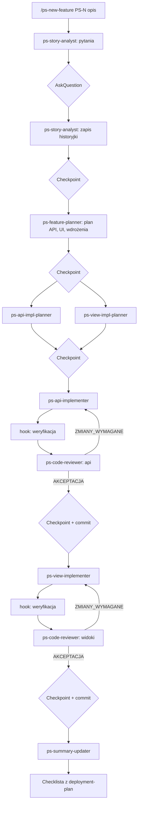

# Usprawnienie flow tworzenia nowych funkcjonalności w Cursorze

Dokument składa się z dwóch części:

1. **Analiza** obecnych reguł (`.cursor/rules`), flow (`docs/flow/flow-new-feature.md`), promptów (`docs/prompts`) i `docs/results/project-summary.md`: niejednoznaczności, luki i błędy.
2. **Plan** przeniesienia tego samego procesu na skille, subagentów i hooki Cursora, tak żeby nową funkcjonalność prowadzić jednym poleceniem z numerem historyjki, bez długich promptów i ręcznego wklejania ścieżek.

Zakres planu: proces pozostaje ten sam co w `flow-new-feature.md` (analiza → historyjka → plan API/UI/wdrożenia → plany implementacji → implementacja API → implementacja widoków → aktualizacja summary). Dochodzi tylko niezależny reviewer kodu (na życzenie). Testy E2E są celowo pominięte.

---

## Spis treści

- [Część I — Analiza obecnego stanu](#część-i--analiza-obecnego-stanu)
    - [1. Reguły `.cursor/rules`](#1-reguły-cursorrules)
    - [2. Flow `flow-new-feature.md`](#2-flow-flow-new-featuremd)
    - [3. Prompty](#3-prompty)
    - [4. `project-summary.md`](#4-project-summarymd)
    - [5. Przyczyna główna: dlaczego prompty są długie](#5-przyczyna-główna-dlaczego-prompty-są-długie)
- [Część II — Docelowa organizacja pracy](#część-ii--docelowa-organizacja-pracy)
    - [6. Podział odpowiedzialności: reguły, skille, subagenci, hooki](#6-podział-odpowiedzialności-reguły-skille-subagenci-hooki)
    - [7. Konwencje — jedno źródło prawdy](#7-konwencje--jedno-źródło-prawdy)
    - [8. Co trzeba poprawić przed wdrożeniem](#8-co-trzeba-poprawić-przed-wdrożeniem)
    - [9. Skille](#9-skille)
    - [10. Subagenci](#10-subagenci)
    - [11. Hooki](#11-hooki)
    - [12. Przyszły proces krok po kroku](#12-przyszły-proces-krok-po-kroku)
    - [13. Kolejność wdrożenia](#13-kolejność-wdrożenia)
    - [14. Mapowanie promptów na nowe elementy](#14-mapowanie-promptów-na-nowe-elementy)

---

# Część I — Analiza obecnego stanu

## 1. Reguły `.cursor/rules`

### 1.1. Problemy przekrojowe

| # | Problem | Skutek |
|---|---|---|
| R1 | `backend.mdc` i `frontend.mdc` mają `alwaysApply: false`, ale **nie mają ani `globs`, ani `description`**. | Cursor nigdy nie dołącza ich automatycznie, więc trzeba je ręcznie wklejać (`@.cursor/rules/backend.mdc`) do każdego promptu. To jedna z głównych przyczyn długich promptów. |
| R2 | `api-supabase-angular-init.mdc`, `playwright.mdc`, `vitest.mdc` **nie mają frontmattera**. | Ich tryb działania jest niezdefiniowany (w praktyce reguła ręczna). Nie dołączają się przy edycji testów. |
| R3 | **Dane logowania użytkownika testowego (hasło)** są wpisane jawnie w `backend.mdc` i `frontend.mdc`, a oba pliki są w gicie. | Sekret w historii repo, zduplikowany w dwóch miejscach. |
| R4 | Reguły powielają wiedzę domenową z `project-summary.md` (tabele, limity walidacji, lista funkcji). | Dwa źródła prawdy, które już się rozjechały (patrz 1.2). |
| R5 | Mieszanka języków (EN/PL) i poziomów szczegółowości w obrębie jednego pliku. | Trudniej utrzymać, model traktuje sekcje nierówno. |

### 1.2. Uwagi do poszczególnych plików

**`project.mdc`** (jedyna reguła `alwaysApply`)

- Tech stack wymienia tylko Angular 21 i Angular Material — brak Supabase (Edge Functions/Deno, PostgreSQL, RLS), Vitest, OpenAI/Gemini. Agent nie wie z samej reguły, że backend to Supabase.
- Struktura katalogów pomija kluczowe miejsca: `supabase/functions/`, `supabase/migrations/`, `shared/contracts/types.ts`, `docs/results/…`.
- Linia `./src/app/pages/dashboard/{page-name}/ - {page-name}-specific interfaces and data types` jest niezrozumiała (pomylona ścieżka?).
- `./src/app/shared/` jest wymienione dwa razy.
- Opis „wersja MVP” jest nieaktualny — produkt jest dużo dalej (kredyty AI, cennik, oceny, panel admina).
- Literówki („cahracters”), brak polskich znaków przy regule wcięć.

**`backend.mdc`**

- Sekcja „Rekomendowane struktury Edge Functions — dla MVP” (`recipes`, `collections`, `tags`, `profile`) nie odpowiada rzeczywistości: w repo jest 19 funkcji (`ai`, `admin`, `public`, `plan`, `billing`, `checkout`, `payments-webhook`, `explore`, `internal`, …).
- Opis bazy danych (tabele, limity) to stan MVP; brakuje m.in. `user_ai_credits`, `user_recipe_flags`, `recipe_ratings`, `plan_recipes`. To duplikat `project-summary.md` (R4).
- „Używaj transakcji przy operacjach na wielu tabelach” — `supabase-js` nie obsługuje transakcji. Projekt robi to przez funkcje RPC (np. `set_recipe_flags`, `set_recipe_rating`) i reguła powinna to powiedzieć wprost.
- Brak informacji o: kodach błędów używanych w projekcie (`402`, `403`, `409`, `422` z kodami biznesowymi typu `PLAN_LIMIT_EXCEEDED_FREE`), roli z JWT (`app_metadata.app_role`), sposobie tworzenia migracji i regeneracji typów.
- Hasło testowe (R3).

**`frontend.mdc`**

- Sekcja **NGRX** — NgRx nie występuje w `package.json`, a ta sama reguła każe używać sygnałów. Sprzeczność, która może skłonić model do dodania NgRx.
- „Create a dedicated module for Angular Material imports” jest sprzeczne z „Use standalone components … instead of NgModules”.
- „Use TypeScript decorators with explicit visibility modifiers” — niejasne sformułowanie.
- Hasło testowe (R3).

**`api-supabase-angular-init.mdc`**

- To jednorazowy przewodnik inicjalizacji, a nie reguła. Zawiera przykłady **sprzeczne z `frontend.mdc`**: komponent wywołuje `supabase.from('recipes')` (zakazane „KRYTYCZNIE”), selektor `app-example` (wymagany prefiks `pych`), wstrzykiwanie przez konstruktor, wcięcia 2-spacjowe.
- Port `54321` — w `supabase/config.toml` API działa na `54331`.
- Wspomina Angular 20.

**`vitest.mdc`** — merytorycznie dobra. Brak frontmattera z `globs: **/*.spec.ts`. „Monitor coverage … only when asked” jest sprzeczne z „pokrycie ≥80%” w `project-summary.md` (sekcja 7).

**`playwright.mdc`** — „Initialize configuration only with Chromium” (i tak jest w `playwright.config.ts`), a `project-summary.md` deklaruje Chromium, Firefox i WebKit. E2E jest poza zakresem tego planu, ale sprzeczność warto odnotować.

**`github-action.mdc`** — pusty `description`. Poleca `digitalocean/action-doctl` (hosting to Firebase), `microsoft/playwright-github-action@v1` (przestarzała akcja). „Always use PowerShell command to verify branch” miesza środowisko lokalne z runnerem GitHuba.

## 2. Flow `flow-new-feature.md`

| # | Problem | Opis |
|---|---|---|
| F1 | **Luka między ścieżką epic a planem implementacji** | Epic kończy się dokumentem `…-user-stories.md` (krótkie historyjki z checklistą). Krok „Plan implementacji” (047) oczekuje pliku pojedynczej historyjki w `user-stories/PS-{N}/PS-{N}-…-user-story.md` z kryteriami Given-When-Then. Nie ma kroku, który z historyjki epiku robi taki plik. |
| F2 | **Wynik review (044) nie trafia nigdzie** | „W razie potrzeby skoryguj dokument, kontynuując konwersację” — nie wiadomo, kto nanosi poprawki (model autora czy recenzenta) ani gdzie zapisać wynik review. |
| F3 | **Brak kroku code review** | DoD w historyjce (046) wymaga „Code review zakończone pozytywnie”, ale flow go nie przewiduje. |
| F4 | **Brak weryfikacji po implementacji** | Ani flow, ani prompty 015/020 nie każą uruchomić lintera, buildu czy testów jednostkowych. DoD (046) wymaga testów jednostkowych. |
| F5 | **Plan wdrożenia (`deployment-plan.md`) nie jest nigdzie konsumowany** | 047 go tworzy, ale żaden krok nie mówi, kiedy wykonać opisane czynności ręczne (sekrety, migracje na produkcji, konfiguracja usług). |
| F6 | **Migracje bazy i typy nie mają miejsca w flow** | Plan API często wymaga migracji (np. PS-99: `recipe_ratings`, RPC). Prompt 010 (migracje) i 013 (typy DTO) nie są w flow, a 015 nie wspomina o migracjach. Nie wiadomo też, kto aktualizuje `shared/contracts/types.ts`, z którego korzysta implementacja widoków. |
| F7 | **Kolejność kroków niejawna** | Plan widoków (049) korzysta z `api-plan.md`, nie z planu implementacji API, więc plany 048 i 049 mogą powstać równolegle. Implementacja widoków musi jednak iść po implementacji API (kontrakty). Flow tego nie mówi. |
| F8 | **Kryterium wyboru ścieżki** | „Więcej niż jedna historyjka” — decyzję trzeba podjąć przed analizą, która dopiero ujawnia liczbę historyjek. 046 może zresztą sam zaproponować podział na kilka historyjek. |
| F9 | **Drobne** | Literówki, zakotwiczenia linków (`#user-stories`, `#pojedyncza-historyjka-użytkownika`) nie pasują do nagłówków, więc linki w dokumencie nie działają. |

## 3. Prompty

### 3.1. Problemy przekrojowe

| # | Problem |
|---|---|
| P1 | **Ścieżki i numery wpisane na sztywno** w treści: `PS-100` w 047/048/049/015/020, `ps96` w 050, „Numerację zacznij od 63” w 045, `100` w 046. Każde użycie wymaga ręcznej edycji promptu. |
| P2 | **Niespójne ścieżki wyjściowe**: 043 → `doc/analiza-funkcjonalnosci-…` (katalog `doc/` nie istnieje; epiki leżą w `docs/results/new-features/epics/…`); 045 podaje w jednym pliku **dwie różne ścieżki** (`doc/new-features/{x}/{x}-user-stories.md` i `doc/{x}-user-stories.md`); 046/047 → `docs/results/new-features/user-stories/PS-{N}/`; 048 → `impl-plans/endpoints/PS-{N}-…`; 049 → `impl-plans/views/{numer}-…` (bez prefiksu `PS-`). |
| P3 | **Niespójne nazwy plików w repo** jako skutek P2: `ps96-…`, `PS-96-…`, `ps65-…`, `unified-entitlements-…`, foldery historyjek raz `PS-95`, raz `ai-credits`/`pricing-page`. Agent nie zgadnie ścieżki — dlatego trzeba je wklejać. |
| P4 | **Niespójne placeholdery**: `{{nazwa-obszaru}}` (043), `{project-summary}` (044, 045), `@ścieżka` w tagach XML (046–050), `{numer_historyjki}` vs `{story-no}` vs `{story-number}`. |
| P5 | **Nieaktualne wejście**: 048 i 049 dołączają `docs/results/main-project-docs/006 Tech Stack.md`, który opisuje Angular 20; aktualny stack jest w `project-summary.md` (sekcja 3). |
| P6 | **Rundy pytań** (043, 046, 047) są opisane ręcznie formatem tekstowym; w Cursorze lepiej zrobić to narzędziem pytań (AskQuestion) przez agenta-orkiestratora. |

### 3.2. Uwagi do konkretnych promptów

- **043** — wynik do nieistniejącego `doc/`; brak numeracji/identyfikatora epiku.
- **044** — kryterium „maksymalizacja zysków z witryny” narzuca czysto przychodową ocenę (dla funkcji UX może być mylące); brak instrukcji, gdzie zapisać wynik i jak go nanieść (F2).
- **045** — sprzeczność formatu identyfikatorów: nagłówki `PS-{numer}`, a wymagania i zależności `US-001` / `US-{numer}`; dwie ścieżki wyjściowe; brak kryteriów Given-When-Then (niezgodne z 046, patrz F1).
- **046** — „Numer nadaj sekwencyjnie, zacznij od 001 lub zapytaj” jest sprzeczne z polem `<numer_historyjki>100`; DoD wymaga testów i code review, których flow nie ma (F3, F4).
- **047** — prosi o „4 sekcje”, w tym „wymagania (funkcje i taski)” oraz „przynajmniej jedną szczegółową historyjkę”, ale zapisuje tylko 3 pliki, a historyjka już istnieje (duplikacja); pusta sekcja `<functionality_analysis>`; nie mówi, czy plan API ma uwzględniać migracje.
- **048** — lista kodów statusu pomija `402/403/409/422`, których projekt intensywnie używa (kredyty AI, role, duplikaty, limity); punkt „rejestrowanie błędów w tabeli błędów” — takiej tabeli nie ma; dwie sekcje o numerze 3; zepsuty blok kodu (` ``markdown `); literówka „endpowinew”.
- **049** — numeracja wejść 1, 2, 3, 5, 7, 8, 9 (luki po usuniętych sekcjach) i odwołania do nieistniejących wejść („PRD”, „Endpoint Implementation”); terminologia React („custom hooki”, „propsy”, „re-render”) w projekcie Angular; nazwa pliku bez `PS-`.
- **015** — ogólnik „dekorator metody HTTP” nie pasuje do Edge Functions w Deno; brak migracji, regeneracji typów i weryfikacji (`deno check`/testy).
- **020** — terminologia React; testy „jeśli określone w planie” jest sprzeczne z DoD; brak weryfikacji (`ng lint`, build, Vitest).
- **050** — ścieżki `ps96` na sztywno; nie każe zapisać pliku (zwraca tekst z nagłówkiem „(zaktualizowane)” i doklejoną „Listą zmian”, które po wklejeniu zaśmiecają dokument); opiera się na **planach**, a nie na faktycznie wprowadzonym kodzie; nie uwzględnia historyjki ani planu wdrożenia; brak reguły zwięzłości (patrz 4).
- **Porządek w katalogu**: dwa pliki o numerze `024`; `040–042` to legacy-kopie 025/019/014; literówki w nazwach plików („Micgration”, „imlementation”, „comonents”).

## 4. `project-summary.md`

| # | Problem |
|---|---|
| S1 | **Rozmiar i redundancja** — ~51 KB (~600 linii). Każda funkcja (np. PS-95) jest opisana 4–5 razy: w sekcji 0 (stan), „Dostarczone poza…”, sekcji 1 (założenia), sekcji 2 (user stories), sekcji 6 (widoki). Każdy krok flow wczytuje cały plik, więc koszt kontekstu rośnie z każdą historyjką, a 050 powiększa go dalej. |
| S2 | **Rozjazd z kodem** — w `supabase/functions` są funkcje `billing`, `checkout`, `payments-webhook`, a summary twierdzi, że płatności nie mają API („stub `/checkout`, bez wywołań API”). Do weryfikacji: albo to niedokończony PS-66, albo summary nie zostało zaktualizowane. |
| S3 | **Martwe odwołania** — `docs/analizaf0funkcjonalnosci-premium-v02.md` i `docs/historyjki-premium.md` nie istnieją; epik premium jest w `docs/results/new-features/epics/premium-users/`. |
| S4 | **Mieszane schematy identyfikatorów** — `US-0xx`, `PS-xx`, `US-OAUTH-xxx`, `US-ADM-xxx`, `PREM-xxx`; tabela w sekcji 2 nie jest posortowana (PS-92…PS-99 wstawione w środek US-027…US-028). |
| S5 | **Sprzeczności** — E2E na „Chromium, Firefox, WebKit” vs konfiguracja tylko Chromium; „pokrycie ≥80%” vs reguła Vitest „coverage tylko na prośbę”. |
| S6 | **Dane migawkowe** — „Eksport Jira (59 zgłoszeń): 48 Gotowe…” starzeje się z każdą historyjką i nikt go nie aktualizuje (050 tego nie przewiduje). |
| S7 | **Znana niespójność produktowa opisana, ale bez decyzji** — API draftu AI przyjmuje rolę `user`, a UI asysty wymaga `premium`. Summary to opisuje w kilku miejscach; warto zdecydować i usunąć powtórzenia. |

## 5. Przyczyna główna: dlaczego prompty są długie

Prompty muszą dziś przenosić trzy rodzaje informacji, które powinny żyć gdzie indziej:

1. **Instrukcję wykonania kroku** (rola, proces, szablon dokumentu) → to powinien być **skill** wczytywany po nazwie.
2. **Ścieżki do dokumentów wejściowych** → to powinna być **konwencja**: z samego `PS-{N}` da się wyliczyć wszystkie ścieżki.
3. **Reguły kodu** (`backend.mdc`, `frontend.mdc`) → to powinny być reguły z `globs`, dołączane automatycznie przy edycji plików.

Po rozdzieleniu tych trzech rzeczy jedyną zmienną daną wejściową zostaje numer historyjki i opis wymagania.

---

# Część II — Docelowa organizacja pracy

## 6. Podział odpowiedzialności: reguły, skille, subagenci, hooki

| Mechanizm | Co przechowuje | Kiedy działa | Przykład w projekcie |
|---|---|---|---|
| **Reguła** (`.cursor/rules/*.mdc`) | Stałe standardy kodu i architektury | Automatycznie, gdy agent dotyka pliku pasującego do `globs` | `backend.mdc` przy edycji `supabase/functions/**` |
| **Skill** (`.cursor/skills/<nazwa>/SKILL.md`) | Procedura jednego kroku + szablon dokumentu (dawny prompt) | Gdy użytkownik wywoła `/nazwa` albo subagent go wczyta | `ps-api-impl-plan` = dawny prompt 048 |
| **Subagent** (`.cursor/agents/<nazwa>.md`) | Rola, model, uprawnienia (readonly), który skill wykonać | Uruchamiany przez orkiestratora, dostaje **świeży kontekst** | `ps-api-implementer` |
| **Hook** (`.cursor/hooks.json` + skrypty) | Deterministyczne strażniki i automatyczna weryfikacja | Na zdarzeniach agenta (komenda shell, zapis pliku, koniec subagenta) | Blokada `supabase functions deploy`, uruchomienie lintera po implementacji |

Zasady podziału:

- **Subagent jest cienki** — mówi *kim jest* i *który skill wykonuje*. Cała procedura jest w skillu, żeby dało się ją uruchomić także ręcznie bez subagenta.
- **Skill nie powiela reguł** — skill implementacji mówi „przestrzegaj reguł backendu”; sama reguła dołącza się przez `globs`.
- **Orkiestrator rozmawia z użytkownikiem, subagenci pracują.** Subagent nie prowadzi dialogu w trakcie działania, więc rundy pytań (dawne 043/046/047) działają tak: subagent w trybie `pytania` zwraca listę pytań z rekomendacjami, orkiestrator zadaje je narzędziem AskQuestion, potem wywołuje subagenta ponownie z odpowiedziami.
- **Checkpointy ludzkie zostają** tam, gdzie flow dziś mówi „Zrewiduj i skoryguj” — orkiestrator zatrzymuje się i pyta: „Akceptuję / Popraw: …”.

Docelowa struktura `.cursor/`:

```
.cursor/
├── rules/
│   ├── project.mdc                  # alwaysApply (poprawiony)
│   ├── backend.mdc                  # globs: supabase/**
│   ├── frontend.mdc                 # globs: src/**
│   ├── vitest.mdc                   # globs: **/*.spec.ts, **/*.test.ts
│   ├── playwright.mdc               # globs: e2e/**
│   └── github-action.mdc            # globs: .github/workflows/**
├── skills/
│   ├── ps-feature-conventions/      # konwencje ścieżek i ID (referencja dla wszystkich)
│   ├── ps-new-feature/              # orkiestrator: pojedyncza historyjka
│   ├── ps-new-epic/                 # orkiestrator: epic
│   ├── ps-epic-analysis/            # 043
│   ├── ps-epic-review/              # 044
│   ├── ps-epic-user-stories/        # 045
│   ├── ps-user-story/               # 046
│   ├── ps-feature-plan/             # 047
│   ├── ps-api-impl-plan/            # 048
│   ├── ps-view-impl-plan/           # 049
│   ├── ps-implement-api/            # 015
│   ├── ps-implement-view/           # 020
│   ├── ps-code-review/              # nowy: niezależny review
│   └── ps-summary-update/           # 050
├── agents/
│   ├── ps-story-analyst.md
│   ├── ps-analysis-reviewer.md
│   ├── ps-feature-planner.md
│   ├── ps-api-impl-planner.md
│   ├── ps-view-impl-planner.md
│   ├── ps-api-implementer.md
│   ├── ps-view-implementer.md
│   ├── ps-code-reviewer.md
│   └── ps-summary-updater.md
├── hooks.json
└── hooks/
    ├── guard-shell.ps1
    ├── guard-paths.ps1
    └── verify-implementation.ps1
```

Prefiks `ps-` oddziela skille projektu od skilli wbudowanych i ułatwia wyszukiwanie po `/ps`.

## 7. Konwencje — jedno źródło prawdy

To jest najważniejsza zmiana. Konwencje zapisujemy **raz**, w skillu `ps-feature-conventions`, a wszystkie inne skille i subagenci się do niego odwołują. Dzięki temu z samego `PS-101` każdy agent wylicza ścieżki.

### 7.1. Identyfikatory

- Historyjka: `PS-{N}` — numer z Jiry. Jeśli użytkownik nie poda numeru, analityk proponuje `max(PS-*) + 1` na podstawie folderów w `docs/results/new-features/user-stories/` i **pyta o potwierdzenie** (numer musi zgadzać się z Jirą).
- Slug: angielski, `kebab-case`, max ~5 słów, ustalany **raz** przy tworzeniu historyjki i odczytywany potem z nazwy pliku historyjki.
- Epic: `{obszar}` po angielsku w `kebab-case` (np. `premium-users`).

### 7.2. Ścieżki

| Artefakt | Ścieżka |
|---|---|
| Analiza epiku | `docs/results/new-features/epics/{obszar}/{obszar}-analysis.md` |
| Review analizy epiku | `docs/results/new-features/epics/{obszar}/{obszar}-analysis-review.md` |
| Historyjki epiku | `docs/results/new-features/epics/{obszar}/{obszar}-user-stories.md` |
| Historyjka | `docs/results/new-features/user-stories/PS-{N}/PS-{N}-{slug}-user-story.md` |
| Plan API | `docs/results/new-features/user-stories/PS-{N}/PS-{N}-{slug}-api-plan.md` |
| Plan UI | `docs/results/new-features/user-stories/PS-{N}/PS-{N}-{slug}-ui-plan.md` |
| Plan wdrożenia | `docs/results/new-features/user-stories/PS-{N}/PS-{N}-{slug}-deployment-plan.md` |
| Plan implementacji API | `docs/results/impl-plans/endpoints/PS-{N}-{slug}-api-implementation-plan.md` |
| Plan implementacji widoków | `docs/results/impl-plans/views/PS-{N}-{slug}-view-implementation-plan.md` |
| Kontrakty (DTO) | `shared/contracts/types.ts` |
| Podsumowanie projektu | `docs/results/project-summary.md` |

Lokalizacje są te same co dziś (żadnej przeprowadzki istniejących plików nie trzeba robić), ujednolicone są tylko nazwy. Stare pliki (`ps96-…`, `ai-credits/…`) można zostawić; konwencja dotyczy nowych historyjek.

### 7.3. Wykrywanie stanu historyjki

Orkiestrator ustala, na którym etapie jest historyjka, po **istnieniu plików** (bez osobnego pliku statusu):

| Istnieje | Następny krok |
|---|---|
| nic | analiza → historyjka |
| `user-story.md` | plan API / UI / wdrożenia |
| `api-plan.md` + `ui-plan.md` | plany implementacji |
| oba plany implementacji | implementacja API |
| implementacja API zaakceptowana (commit z `PS-{N}` w opisie) | implementacja widoków |
| implementacja widoków zaakceptowana | aktualizacja summary |

Dzięki temu `/ps-new-feature PS-101` można przerwać i wznowić w dowolnym momencie.

### 7.4. Co czytać z `project-summary.md`

Żeby ograniczyć kontekst: analityk i planista funkcjonalności czytają cały plik; planiści implementacji czytają sekcje 3–6 (stack, baza, API, widoki); implementerzy czytają tylko swoje plany i kod.

## 8. Co trzeba poprawić przed wdrożeniem

### 8.1. Reguły

1. **`backend.mdc`** — frontmatter:
    ```yaml
    ---
    description: Standardy Supabase Edge Functions, migracji i RLS w projekcie PychaŚwiatowa
    globs: supabase/**
    alwaysApply: false
    ---
    ```
    Usunąć: sekcję „Rekomendowane struktury dla MVP”, opis tabel i limitów (źródłem prawdy jest summary + migracje), hasło testowe. Zmienić „używaj transakcji” na „operacje wielotabelowe realizuj przez funkcję RPC w migracji”. Dodać: kody `402/403/409/422` i format błędu `{ code, message, details }`, rola wyłącznie z JWT (`app_metadata.app_role`), krok „po migracji: `supabase gen types` i aktualizacja `shared/contracts/types.ts`”.
2. **`frontend.mdc`** — frontmatter z `globs: src/**` i `description`. Usunąć sekcję NgRx, zdanie o module Material, hasło testowe. Doprecyzować „visibility modifiers”.
3. **`api-supabase-angular-init.mdc`** — przenieść poza reguły (np. do `docs/configuration/`) albo usunąć; to jednorazowy bootstrap sprzeczny z `frontend.mdc`.
4. **`vitest.mdc`** — dodać frontmatter `globs: **/*.spec.ts, **/*.test.ts`.
5. **`playwright.mdc`** — dodać frontmatter `globs: e2e/**`; ujednolicić z summary listę przeglądarek (poza zakresem tego planu, ale tania poprawka).
6. **`github-action.mdc`** — `description` + `globs: .github/workflows/**`; usunąć DigitalOcean i przestarzałą akcję Playwright.
7. **`project.mdc`** — uzupełnić tech stack o Supabase (PostgreSQL, Auth, Storage, Edge Functions/Deno), Vitest, OpenAI/Gemini; dodać do struktury `supabase/functions/`, `supabase/migrations/`, `shared/contracts/`, `docs/results/`; usunąć zdublowaną linię `shared/` i niezrozumiałą linię `pages/dashboard/{page-name}`; zamienić „MVP” na aktualny opis; dodać jedno zdanie: „Konwencje dokumentów i numeracji historyjek: skill `ps-feature-conventions`”.
8. **Dane testowe** — przenieść e-mail i hasło użytkownika testowego do `.env.local` (już ignorowany przez `.env.*` w `.gitignore`) jako `TEST_USER_EMAIL` / `TEST_USER_PASSWORD`; w regułach zostawić tylko odwołanie do zmiennych. Zmienić hasło, bo stare jest w historii gita.

### 8.2. `project-summary.md`

1. Zweryfikować funkcje `billing`, `checkout`, `payments-webhook` i opisać je albo oznaczyć jako „w toku” (S2).
2. Poprawić martwe odwołania do epiku premium (S3).
3. Usunąć redundancję (S1): szczegóły historyjki trzymać w jej folderze; w summary zostawić **jeden** akapit na historyjkę w sekcji 0 oraz wpisy w tabelach sekcji 2, 5, 6. Usunąć listę „Dostarczone poza pierwotnym szkicem summary” (powiela sekcję 0).
4. Usunąć migawkę Jiry albo przenieść ją do jednego wiersza z datą (S6).
5. Ujednolicić przeglądarki E2E i próg pokrycia z regułami (S5).
6. Zdecydować o roli `user` w asyście AI i opisać decyzję w jednym miejscu (S7).

Te zasady zwięzłości trafiają też do skilla `ps-summary-update`, żeby summary nie puchło ponownie.

### 8.3. Prompty → skille

Przy przenoszeniu treści promptów do skilli naprawić błędy z sekcji 3:

- usunąć wszystkie ścieżki i numery na sztywno — zastąpić odwołaniem do `ps-feature-conventions`;
- jeden format identyfikatora `PS-{N}` (także w zależnościach historyjek epiku);
- 045: kryteria akceptacji w Given-When-Then (zgodnie z 046), żeby historyjka z epiku nadawała się wprost do planu (F1);
- 047: usunąć sekcję „wymagania/historyjka” (duplikat); plan API ma jawnie wymieniać migracje i zmiany w `shared/contracts/types.ts` (F6);
- 048: pełna lista kodów statusu używanych w projekcie, usunąć „tabelę błędów”, naprawić numerację i blok kodu;
- 049 i 020: terminologia Angular (komponenty standalone, `input()`/`output()`, sygnały, serwisy), uporządkowana lista wejść;
- 015 i 020: sekcja „Weryfikacja” (patrz hooki) i testy jednostkowe zgodnie z DoD historyjki;
- 050: zapis bezpośrednio do pliku, lista zmian tylko w odpowiedzi czatu, źródłem jest faktyczny diff kodu, a nie same plany;
- zamiast `006 Tech Stack.md` korzystać z sekcji 3 summary.

Po przeniesieniu przenieść `docs/prompts/` w całości do `docs/prompts/archive/` (albo zostawić jako historię), żeby nie było dwóch wersji tej samej instrukcji.

## 9. Skille

### 9.1. Lista

| Skill | Wywołanie | Źródło | Zadanie |
|---|---|---|---|
| `ps-feature-conventions` | czytany przez innych | nowy (sekcja 7) | ID, slug, ścieżki, wykrywanie stanu, zakres czytania summary |
| `ps-new-feature` | `/ps-new-feature PS-{N} [opis]` | `flow-new-feature.md` | Orkiestrator pojedynczej historyjki |
| `ps-new-epic` | `/ps-new-epic {obszar} [opis]` | `flow-new-feature.md` | Orkiestrator epiku |
| `ps-epic-analysis` | przez `ps-story-analyst` | 043 | Analiza funkcji obszaru z klasyfikacją |
| `ps-epic-review` | przez `ps-analysis-reviewer` | 044 | Krytyczny review analizy |
| `ps-epic-user-stories` | przez `ps-story-analyst` | 045 | Historyjki epiku z zależnościami |
| `ps-user-story` | przez `ps-story-analyst` | 046 | Pojedyncza historyjka (także rozwinięcie historyjki z epiku) |
| `ps-feature-plan` | przez `ps-feature-planner` | 047 | Plan API, UI, wdrożenia |
| `ps-api-impl-plan` | przez `ps-api-impl-planner` | 048 | Plan implementacji API |
| `ps-view-impl-plan` | przez `ps-view-impl-planner` | 049 | Plan implementacji widoków |
| `ps-implement-api` | przez `ps-api-implementer` | 015 | Implementacja API + migracje + kontrakty |
| `ps-implement-view` | przez `ps-view-implementer` | 020 | Implementacja widoków |
| `ps-code-review` | przez `ps-code-reviewer` | nowy | Niezależny review zmian |
| `ps-summary-update` | przez `ps-summary-updater` | 050 | Aktualizacja summary |

Każdy skill kroku można też wywołać ręcznie (np. `/ps-api-impl-plan PS-101`), jeśli chcesz wykonać tylko jeden krok w głównym czacie.

Ustawienia frontmattera:

- orkiestratory (`ps-new-feature`, `ps-new-epic`): `disable-model-invocation: true` — uruchamiane tylko jawnie przez `/`;
- skille kroków: również `disable-model-invocation: true`; subagent wczytuje je po ścieżce, więc nie muszą być wykrywane automatycznie;
- `ps-feature-conventions`: bez `disable-model-invocation`, żeby agent mógł go sam dobrać, gdy rozmowa dotyczy dokumentów historyjek.

### 9.2. Budowa skilla kroku

Każdy skill kroku ma ten sam układ: `SKILL.md` (proces, krótki) + `template.md` (struktura dokumentu wynikowego, przeniesiona z promptu). Przykład:

```
.cursor/skills/ps-api-impl-plan/
├── SKILL.md
└── template.md
```

```markdown
---
name: ps-api-impl-plan
description: Tworzy plan implementacji API (Supabase Edge Functions) dla historyjki PS-{N} na podstawie historyjki i planu API. Używany przez subagenta ps-api-impl-planner albo ręcznie przez /ps-api-impl-plan PS-{N}.
disable-model-invocation: true
---

# Plan implementacji API

## Wejście
- Identyfikator historyjki `PS-{N}`.
- Ścieżki wylicz według `.cursor/skills/ps-feature-conventions/SKILL.md`. Jeśli brakuje pliku historyjki lub planu API, zatrzymaj się i zgłoś, czego brakuje.

## Czytaj
1. Historyjka i plan API (`PS-{N}-{slug}-user-story.md`, `PS-{N}-{slug}-api-plan.md`).
2. `docs/results/project-summary.md` — sekcje 3–6.
3. `shared/contracts/types.ts` oraz istniejący kod funkcji, której dotyczy zmiana (`supabase/functions/{funkcja}/`).
4. `.cursor/rules/backend.mdc`.

## Proces
1. Wypisz endpointy, parametry, typy DTO/Command, potrzebne migracje i RPC.
2. Zaplanuj walidację (Zod), autoryzację (rola z JWT), błędy i kody: 200, 201, 204, 400, 401, 402, 403, 404, 409, 422, 500.
3. Wskaż zmiany w `shared/contracts/types.ts`.

## Wynik
- Zapisz plan zgodnie z [template.md](template.md) pod ścieżką z konwencji.
- W odpowiedzi zwróć: ścieżkę pliku, listę otwartych pytań i założeń (bez powtarzania treści planu).
```

### 9.3. Orkiestrator `ps-new-feature`

Szkielet `SKILL.md` (proces jest opisany szczegółowo w sekcji 12):

```markdown
---
name: ps-new-feature
description: Prowadzi pojedynczą historyjkę PS-{N} przez cały proces: historyjka, plan API/UI/wdrożenia, plany implementacji, implementacja API, implementacja widoków, code review, aktualizacja summary. Wznawia pracę od etapu wynikającego z istniejących plików.
disable-model-invocation: true
---

# Nowa funkcjonalność — orkiestrator

1. Wczytaj `.cursor/skills/ps-feature-conventions/SKILL.md`.
2. Ustal etap historyjki według tabeli „Wykrywanie stanu”. Pokaż użytkownikowi etap i następny krok.
3. Wykonuj etapy po kolei, każdy przez dedykowanego subagenta. Po każdym etapie zatrzymaj się i zapytaj (AskQuestion): „Akceptuję” / „Popraw” / „Przerwij”.
4. Rundy pytań: wywołaj subagenta w trybie `pytania`, przedstaw pytania przez AskQuestion (rekomendacja jako pierwsza opcja), wywołaj subagenta ponownie z odpowiedziami.
5. Subagentom przekazuj tylko: `PS-{N}`, tryb, odpowiedzi użytkownika i uwagi z checkpointu. Nie przekazuj treści dokumentów — subagent czyta je sam.
6. Code review: po każdej implementacji uruchom `ps-code-reviewer`. Przy werdykcie `ZMIANY_WYMAGANE` przekaż uwagi implementerowi; maksymalnie 2 rundy, potem decyzja użytkownika.
7. Na końcu pokaż checklistę z `deployment-plan.md` (czynności ręczne) i przypomnij o commicie.
```

## 10. Subagenci

### 10.1. Format pliku

Każdy subagent to plik `.cursor/agents/<nazwa>.md` z frontmatterem:

| Pole | Znaczenie |
|---|---|
| `name` | Identyfikator, którym orkiestrator wywołuje subagenta |
| `description` | Kiedy go używać (orkiestrator i Cursor dobierają po opisie) |
| `model` | `inherit` (model z czatu) albo konkretny model z listy w ustawieniach Cursora |
| `readonly` | `true` — subagent nie może edytować plików ani uruchamiać zmieniających komend |

Treść pliku to krótki prompt systemowy: rola, wejście, który skill wykonać, format odpowiedzi.

### 10.2. Lista subagentów

| Subagent | Skill(e) | `readonly` | Model | Wejście | Wynik |
|---|---|---|---|---|---|
| `ps-story-analyst` | `ps-user-story`, `ps-epic-analysis`, `ps-epic-user-stories` | `false` | `inherit` | `PS-{N}` lub `{obszar}`, tryb (`pytania` / `zapis` / `z-epiku`), opis, odpowiedzi | Pytania z rekomendacjami **albo** plik historyjki/analizy |
| `ps-analysis-reviewer` | `ps-epic-review` | `false` (zapisuje tylko plik review) | **inna rodzina modeli** niż analityk | `{obszar}` | `{obszar}-analysis-review.md` |
| `ps-feature-planner` | `ps-feature-plan` | `false` | `inherit` | `PS-{N}`, tryb, odpowiedzi | `api-plan`, `ui-plan`, `deployment-plan` |
| `ps-api-impl-planner` | `ps-api-impl-plan` | `false` | `inherit` | `PS-{N}` | Plan implementacji API |
| `ps-view-impl-planner` | `ps-view-impl-plan` | `false` | `inherit` | `PS-{N}` | Plan implementacji widoków |
| `ps-api-implementer` | `ps-implement-api` | `false` | `inherit` | `PS-{N}`, ewentualne uwagi z review | Kod funkcji, migracje, `shared/contracts/types.ts`, testy jednostkowe serwisów |
| `ps-view-implementer` | `ps-implement-view` | `false` | `inherit` | `PS-{N}`, ewentualne uwagi z review | Komponenty, serwisy, routing, testy Vitest |
| `ps-code-reviewer` | `ps-code-review` | **`true`** | **inna rodzina modeli** niż implementer | `PS-{N}`, zakres (`api` / `widoki`) | Raport w odpowiedzi: werdykt + uwagi |
| `ps-summary-updater` | `ps-summary-update` | `false` | `inherit` | `PS-{N}` | Zaktualizowany `project-summary.md` + lista zmian w odpowiedzi |

`ps-analysis-reviewer` i `ps-code-reviewer` celowo działają na innym modelu — to ten sam mechanizm, który flow stosuje dziś przy 044 („innego modelu”). Konkretny model wybierz z listy w ustawieniach Cursora; zasada: inna rodzina niż model, którym pracujesz na co dzień.

### 10.3. Przykładowe definicje

**`.cursor/agents/ps-story-analyst.md`**

```markdown
---
name: ps-story-analyst
description: Analityk wymagań PychaŚwiatowa. Tworzy historyjkę użytkownika PS-{N} z opisu wymagania lub z historyjki epiku, a dla epiku — analizę funkcji i listę historyjek. Używaj na początku każdej nowej funkcjonalności.
model: inherit
readonly: false
---

Jesteś Business Analystem i Product Ownerem projektu PychaŚwiatowa.

Zawsze najpierw przeczytaj `.cursor/skills/ps-feature-conventions/SKILL.md`.

Tryby (podaje orkiestrator):
- `pytania` — przeczytaj summary i opis wymagania, zwróć 3–7 pytań doprecyzowujących, każde z rekomendowaną odpowiedzią. Niczego nie zapisuj.
- `zapis` — wykonaj `.cursor/skills/ps-user-story/SKILL.md` z uwzględnieniem odpowiedzi użytkownika.
- `z-epiku` — rozwiń historyjkę PS-{N} z dokumentu epiku do pełnego pliku historyjki (ten sam skill).
- `epic-analiza` / `epic-historyjki` — wykonaj odpowiednio `ps-epic-analysis` / `ps-epic-user-stories`.

Jeśli wymaganie trzeba podzielić na kilka historyjek, nie zapisuj plików — zwróć propozycję podziału.

Odpowiedź: ścieżki zapisanych plików, przyjęte założenia, otwarte kwestie. Bez powtarzania treści dokumentu.
```

**`.cursor/agents/ps-api-implementer.md`**

```markdown
---
name: ps-api-implementer
description: Implementuje warstwę API (Supabase Edge Functions, migracje, RPC, kontrakty w shared/contracts/types.ts) dla historyjki PS-{N} według zatwierdzonego planu implementacji API. Używaj po akceptacji planu implementacji API.
model: inherit
readonly: false
---

Jesteś starszym programistą backendu (Supabase, Deno, PostgreSQL).

1. Przeczytaj `.cursor/skills/ps-feature-conventions/SKILL.md`.
2. Wykonaj `.cursor/skills/ps-implement-api/SKILL.md` dla podanego `PS-{N}`.
3. Jeśli orkiestrator przekazał uwagi z code review — popraw tylko wskazane miejsca i odnieś się do każdej uwagi.

Nie wdrażaj na środowiska zdalne (deploy robi GitHub Actions). Nie modyfikuj kodu frontendu poza `shared/contracts/types.ts`.

Odpowiedź: lista zmienionych plików, nowe migracje, wynik weryfikacji (lint/testy), odstępstwa od planu z uzasadnieniem.
```

**`.cursor/agents/ps-code-reviewer.md`**

```markdown
---
name: ps-code-reviewer
description: Niezależny reviewer kodu PychaŚwiatowa. Ocenia zmiany dla historyjki PS-{N} (zakres api albo widoki) pod kątem zgodności z historyjką, planem implementacji, regułami projektu i bezpieczeństwem. Nie modyfikuje plików.
model: <model innej rodziny niż implementer>
readonly: true
---

Jesteś niezależnym reviewerem. Nie znasz rozumowania autora kodu i nie zakładasz, że plan został wykonany poprawnie.

1. Przeczytaj `.cursor/skills/ps-feature-conventions/SKILL.md`.
2. Wykonaj `.cursor/skills/ps-code-review/SKILL.md` dla podanego `PS-{N}` i zakresu.

Odpowiedź (dokładnie w tym formacie):
- Werdykt: `AKCEPTACJA` albo `ZMIANY_WYMAGANE`
- Krytyczne (blokujące): `plik:linia` — problem — proponowana poprawka
- Ważne: …
- Sugestie (nieblokujące): …
- Kryteria akceptacji historyjki: które scenariusze są pokryte, których brakuje
```

Pozostałe pliki mają ten sam układ: rola → konwencje → skill → format odpowiedzi.

### 10.4. Skill `ps-code-review` — zakres przeglądu

- **Zakres zmian**: `git diff` niezatwierdzonych zmian (oraz `git diff main...HEAD`, jeśli pracujesz na gałęzi), filtrowany do `supabase/**` + `shared/contracts/**` dla zakresu `api` albo `src/**` dla zakresu `widoki`.
- **Zgodność**: każdy scenariusz Given-When-Then z historyjki ma pokrycie w kodzie; kod realizuje plan implementacji (odstępstwa muszą być opisane przez implementera).
- **Backend**: rola tylko z JWT, walidacja Zod, kody błędów zgodne z planem, soft delete (`deleted_at IS NULL`), RLS w nowych tabelach, operacje wielotabelowe przez RPC, brak sekretów w kodzie, separacja `index.ts` / `handlers` / `service`.
- **Frontend**: brak `supabase.from()` i `supabase.rpc()` w serwisach, komponenty standalone z prefiksem `pych`, sygnały, `OnPush`, nowy control flow, zmienne Material zamiast własnych kolorów, obsługa błędów API w UI.
- **Testy jednostkowe**: istnieją dla nowej logiki zgodnie z DoD historyjki i `vitest.mdc`.
- Reviewer **nie** uruchamia aplikacji i **nie** robi testów E2E.

## 11. Hooki

Hooki pilnują rzeczy, których nie da się powierzyć modelowi: zakazane komendy, konwencje ścieżek i automatyczna weryfikacja po implementacji. Nie dodają nowych kroków procesu.

### 11.1. `hooks.json`

```json
{
    "version": 1,
    "hooks": {
        "beforeShellExecution": [
            {
                "command": "powershell -NoProfile -ExecutionPolicy Bypass -File .cursor/hooks/guard-shell.ps1",
                "failClosed": true,
                "timeout": 10
            }
        ],
        "preToolUse": [
            {
                "command": "powershell -NoProfile -ExecutionPolicy Bypass -File .cursor/hooks/guard-paths.ps1",
                "matcher": "Write|StrReplace|Delete",
                "timeout": 10
            }
        ],
        "subagentStop": [
            {
                "command": "powershell -NoProfile -ExecutionPolicy Bypass -File .cursor/hooks/verify-implementation.ps1",
                "matcher": "ps-api-implementer|ps-view-implementer",
                "timeout": 600,
                "loop_limit": 2
            }
        ]
    }
}
```

`-NoProfile` jest konieczne: obecny profil PowerShella wypisuje błędy `Set-PSReadLineOption` przy przekierowanym wyjściu, co psułoby JSON zwracany przez hook.

### 11.2. `guard-shell.ps1` — zakazane komendy

Cel: agent nie wdraża niczego na środowiska zdalne (to robi GitHub Actions — zgodnie z zasadą z planu wdrożenia) i nie niszczy lokalnych danych bez pytania.

| Wzorzec | Decyzja |
|---|---|
| `supabase functions deploy`, `supabase db push`, `supabase secrets set`, `firebase deploy` | `deny` — wdrożenie tylko przez CI |
| `git push --force`, `git reset --hard` | `deny` |
| `supabase db reset`, `git push` | `ask` — wymaga potwierdzenia użytkownika |
| pozostałe | `allow` |

```powershell
$payload = [Console]::In.ReadToEnd() | ConvertFrom-Json
$command = [string]$payload.command

$denyPatterns = @(
    'supabase\s+functions\s+deploy',
    'supabase\s+db\s+push',
    'supabase\s+secrets\s+set',
    'firebase\s+deploy',
    'git\s+push\s+.*--force',
    'git\s+reset\s+--hard'
)
$askPatterns = @(
    'supabase\s+db\s+reset',
    'git\s+push'
)

foreach ($pattern in $denyPatterns) {
    if ($command -match $pattern) {
        @{
            permission    = 'deny'
            user_message  = "Zablokowano: $command (wdrożenia i operacje destrukcyjne tylko przez CI lub ręcznie)."
            agent_message = 'Ta komenda jest zablokowana w projekcie. Opisz ją jako krok ręczny zamiast ją uruchamiać.'
        } | ConvertTo-Json -Compress
        exit 0
    }
}

foreach ($pattern in $askPatterns) {
    if ($command -match $pattern) {
        @{ permission = 'ask'; user_message = "Potwierdź: $command" } | ConvertTo-Json -Compress
        exit 0
    }
}

@{ permission = 'allow' } | ConvertTo-Json -Compress
```

### 11.3. `guard-paths.ps1` — konwencje ścieżek

Cel: wymusić konwencje z sekcji 7 i chronić pliki wrażliwe. Blokuje (z komunikatem dla agenta, jak poprawić):

- zapis do `doc/**` (nieistniejący katalog, częsty błąd starych promptów);
- zapis do `src/environments/environment.production.ts` i `.env*`;
- zapis do `docs/prompts/**` (archiwum);
- nowe pliki w `docs/results/new-features/user-stories/` i `docs/results/impl-plans/`, których nazwa nie pasuje do wzorca:
  `^PS-\d+-[a-z0-9-]+-(user-story|api-plan|ui-plan|deployment-plan|api-implementation-plan|view-implementation-plan)\.md$`.

Skrypt czyta ścieżkę z `tool_input` (przy pierwszym uruchomieniu zaloguj całe wejście do pliku i sprawdź w kanale **Hooks** dokładną nazwę pola) i zwraca `{"permission":"deny","agent_message":"…"}` albo `{"permission":"allow"}`.

### 11.4. `verify-implementation.ps1` — automatyczna weryfikacja

Uruchamia się, gdy kończy pracę `ps-api-implementer` lub `ps-view-implementer`, czyli realizuje brakujący dziś krok weryfikacji (F4) bez dokładania kroku w procesie.

1. Pobiera listę zmienionych plików z `git diff --name-only` i `git ls-files --others --exclude-standard`.
2. Jeśli są zmiany w `supabase/functions/**`: `deno check` i `deno test` dla zmienionych funkcji (sprawdź wcześniej, że `deno` jest w `PATH`).
3. Jeśli są zmiany w `src/**` lub `shared/**`: `npm run lint`, a potem `npm run test:run`.
4. Testy E2E nie są uruchamiane.
5. Wynik:
    - wszystko przechodzi → `{}`;
    - błąd → `{"followup_message": "Weryfikacja nie przeszła:\n<skrócony log>\nPopraw błędy i zakończ ponownie."}`; `loop_limit: 2` ogranicza liczbę automatycznych poprawek.

## 12. Przyszły proces krok po kroku

### 12.1. Pojedyncza historyjka

Wywołanie:

```
/ps-new-feature PS-101 Chcę móc oznaczyć przepis jako ugotowany i widzieć, ile razy go robiłem
```

Bez opisu (`/ps-new-feature PS-101`) orkiestrator wznawia pracę od etapu wynikającego z plików.

| # | Etap | Kto | Co robisz ty |
|---|---|---|---|
| 1 | **Analiza wymagań → historyjka** | `ps-story-analyst` (tryb `pytania`, potem `zapis`) | Odpowiadasz na pytania w oknie AskQuestion (rekomendacja jest domyślnie pierwsza), akceptujesz lub poprawiasz historyjkę |
| 2 | **Plan API, widoków i wdrożenia** | `ps-feature-planner` (tryb `pytania`, potem `zapis`) | Odpowiadasz na pytania, akceptujesz trzy plany |
| 3 | **Plany implementacji** | `ps-api-impl-planner` i `ps-view-impl-planner` **równolegle** | Akceptujesz lub poprawiasz oba plany |
| 4 | **Implementacja API** | `ps-api-implementer` → hook weryfikacji → `ps-code-reviewer` (zakres `api`) → ewentualne poprawki (max 2 rundy) | Akceptujesz wynik review, robisz commit |
| 5 | **Implementacja widoków** | `ps-view-implementer` → hook weryfikacji → `ps-code-reviewer` (zakres `widoki`) → ewentualne poprawki | Akceptujesz wynik review, robisz commit |
| 6 | **Aktualizacja summary** | `ps-summary-updater` | Przeglądasz diff `project-summary.md` |
| — | Zakończenie | orkiestrator | Dostajesz checklistę czynności ręcznych z `deployment-plan.md` |

Implementacja widoków idzie po API, bo korzysta z kontraktów w `shared/contracts/types.ts` zaktualizowanych na etapie 4. Plany implementacji (etap 3) mogą iść równolegle, bo oba opierają się na planie API z etapu 2.

Diagram:



### 12.2. Epic

```
/ps-new-epic recipe-cooking-history Chcę rozbudować obszar historii gotowania
```

1. `ps-story-analyst` (`epic-analiza`): pytania → AskQuestion → `{obszar}-analysis.md`.
2. `ps-analysis-reviewer` (inny model): `{obszar}-analysis-review.md`.
3. Checkpoint: wybierasz, które rekomendacje review przyjąć; `ps-story-analyst` nanosi je do analizy (rozwiązuje F2).
4. `ps-story-analyst` (`epic-historyjki`): `{obszar}-user-stories.md` z numerami `PS-{N}` potwierdzonymi z Jirą.
5. Dla każdej historyjki: `/ps-new-feature PS-{N}` — orkiestrator wykryje historyjkę w epiku i uruchomi analityka w trybie `z-epiku` zamiast pełnej analizy (rozwiązuje F1).

### 12.3. Co znika w porównaniu z obecnym flow

| Dziś | Po zmianie |
|---|---|
| Kopiowanie promptu, ręczna podmiana `PS-100` i ścieżek w 6–8 miejscach | `/ps-new-feature PS-101` |
| Wklejanie `@.cursor/rules/backend.mdc` / `frontend.mdc` | Reguły dołączają się same przez `globs` |
| Wklejanie `@project-summary.md`, `@types.ts`, planów | Subagent wylicza ścieżki z konwencji i sam czyta pliki |
| Jedna długa rozmowa, w której kontekst każdego kroku zaśmieca następny | Każdy krok w świeżym kontekście subagenta |
| Pytania w formie tekstu do przepisania | Okno AskQuestion z rekomendacją jako domyślną opcją |
| Ręczne pamiętanie, na którym kroku jesteś | Orkiestrator wykrywa etap po plikach |
| Brak review i weryfikacji | Reviewer na innym modelu + hook z lintem i testami jednostkowymi |
| Ręczne wklejanie wyniku 050 do pliku | Subagent zapisuje summary bezpośrednio |

## 13. Kolejność wdrożenia

1. **Porządki w regułach** (sekcja 8.1) i przeniesienie danych testowych do `.env.local`. Od razu skraca obecne prompty, bo reguły zaczną się dołączać same.
2. **`ps-feature-conventions`** + hook `guard-paths.ps1`. Od tej chwili nowe pliki mają jednolite nazwy.
3. **Skille kroków** — przeniesienie promptów 046, 047, 048, 049, 015, 020, 050 z poprawkami z sekcji 8.3. Na tym etapie można już używać ich ręcznie (`/ps-api-impl-plan PS-101`).
4. **Subagenci** — zaczynając od planistów (najmniejsze ryzyko), potem implementerzy, reviewer, updater summary.
5. **Hooki** `guard-shell.ps1` i `verify-implementation.ps1`; test każdego hooka przez wywołanie zdarzenia i podgląd w kanale **Hooks**.
6. **Orkiestrator `ps-new-feature`**.
7. **Pilot** na małej historyjce z backlogu (np. PS-37 „Nazwa użytkownika obok ikony w nawigacji” — mała, dotyka API i widoków). Po pilocie korekta opisów subagentów i skilli.
8. **Epic**: skille 043/044/045 i orkiestrator `ps-new-epic`.
9. **Porządki w dokumentacji**: sekcja 8.2 (`project-summary.md`), archiwizacja `docs/prompts/`, przepisanie `docs/flow/flow-new-feature.md` na nowy proces.

## 14. Mapowanie promptów na nowe elementy

| Prompt | Nowy element | Uwagi |
|---|---|---|
| 043 New features analysis | skill `ps-epic-analysis` (subagent `ps-story-analyst`) | ścieżka do `epics/{obszar}/` |
| 044 New features analysis review | skill `ps-epic-review` (subagent `ps-analysis-reviewer`, inny model) | wynik zapisywany do pliku |
| 045 New features - user stories | skill `ps-epic-user-stories` | ID `PS-{N}`, Given-When-Then |
| 046 New feature - user story | skill `ps-user-story` | tryby `zapis` i `z-epiku` |
| 047 User story plan | skill `ps-feature-plan` (subagent `ps-feature-planner`) | bez duplikatu historyjki, z migracjami |
| 048 API Implementation Plan | skill `ps-api-impl-plan` | pełna lista kodów statusu |
| 049 View Implementation plan | skill `ps-view-impl-plan` | terminologia Angular |
| 015 Endpoint Implementation | skill `ps-implement-api` | migracje, typy, weryfikacja |
| 020 View Implementation | skill `ps-implement-view` | terminologia Angular, weryfikacja |
| — | skill `ps-code-review` (subagent `ps-code-reviewer`) | nowy, na życzenie |
| 050 Project summary update | skill `ps-summary-update` | zapis do pliku, źródło: diff kodu |
| `flow-new-feature.md` | skille `ps-new-feature`, `ps-new-epic` | orkiestratory |
| 040, 041, 042 (legacy) | — | do archiwum |
| 014, 019 | — | zastąpione przez 048 i 049, do archiwum |
| pozostałe (001–013, 016–039) | bez zmian | poza zakresem flow nowej funkcjonalności |
