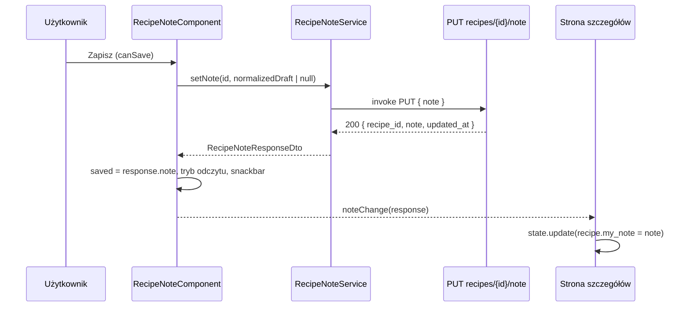

# Plan implementacji widoków — Osobista notatka użytkownika do przepisu (PS-31)

> **Historyjka:** `docs/results/new-features/user-stories/PS-31/PS-31-personal-user-note-on-recipe-user-story.md`
> **Plan UI:** `…/PS-31-personal-user-note-on-recipe-ui-plan.md`
> **Plan API:** `…/PS-31-personal-user-note-on-recipe-api-plan.md` (kontrakt, na którym opiera się front)
> **Stack:** Angular 21 (standalone, signals, OnPush), Angular Material, Sass, Vitest, Playwright
> **Wzorzec:** PS-95 (`RecipeFlagsService`) i PS-99 (`RecipeRatingService` + `RecipeRatingComponent`, w tym `linkedSignal` z ochroną `pending`)

---

## 1. Przegląd

PS-31 **nie dodaje nowej trasy ani nowej strony**. Dodaje sekcję „Moja notatka” do istniejącego, wspólnego widoku szczegółów przepisu (`RecipeDetailViewComponent`), używanego przez:

| Trasa | Strona | Układ |
|---|---|---|
| `/recipes/:id-:slug` (`recipeIdSlugMatcher`) | `RecipeDetailPageComponent` | `MainLayoutComponent` (zalogowany) |
| `/explore/recipes/:id-:slug` (`exploreRecipeIdSlugMatcher`) | `ExploreRecipeDetailPageComponent` | `MainLayoutComponent` (zalogowany, **pierwsza** definicja, ok. linii 119 `app.routes.ts`) oraz `PublicLayoutComponent` (gość, druga definicja, ok. linii 340 — **bez zmian**) |

Zakres frontendu:

1. nowy `RecipeNoteService` (`PUT recipes/{id}/note` przez `supabase.functions.invoke`),
2. nowy `RecipeNoteComponent` (`pych-recipe-note`) — stany pusty / edycja / odczyt, licznik, zapis, usuwanie z potwierdzeniem (dostępne **w trybie edycji i w trybie odczytu**, sc. 6), rollback, snackbary, fokus, a11y,
3. nowy mechanizm ostrzeżenia o niezapisanych zmianach (`UnsavedChangesService` + `unsavedChangesGuard`) — **w aplikacji nie istnieje dziś żaden `CanDeactivate` ani `beforeunload`**,
4. integracja w `RecipeDetailViewComponent` i obu stronach szczegółów,
5. wyodrębnienie pomocnika statusu błędu Edge Function (`core/utils/function-error-status.ts`),
6. testy Vitest i jeden plik E2E Playwright.

**Zależność od etapu API:** kod frontu zakłada, że w `shared/contracts/types.ts` istnieją `SetRecipeNoteRequestDto`, `RecipeNoteResponseDto` oraz `my_note?: string | null` w `RecipeDetailDto`, a `shared/contracts/recipe-note.ts` eksportuje `RECIPE_NOTE_MAX_LENGTH = 2000`. Jeśli implementer widoków startuje przed zaakceptowanym API — te typy trzeba dodać zgodnie z pkt 4.5 planu API (bez rozbieżności nazw).

**Co już działa i nie wymaga zmian** (zweryfikowane w kodzie):
- `RecipesService.getRecipeById` i `ExploreRecipesService.getExploreRecipeById` zwracają `response.data` bez mapowania pól — `my_note` przepłynie do strony automatycznie, gdy API je doda.
- Obie strony trzymają stan w `signal<…State>` i aktualizują przepis przez `state.update(...)` (wzorzec `onFlagsChange` / `onRatingChange`).
- `onLogin()` istnieje w obu stronach (nawigacja do `/login?returnUrl=`).
- `ConfirmDialogComponent` (`shared/components/confirm-dialog`) obsługuje `title`, `message`, `confirmText`, `cancelText`, `confirmColor`.
- Struktura katalogów z `project.mdc` **nie wymaga aktualizacji** (wszystkie nowe pliki trafiają do istniejących `core/services`, `core/guards`, `core/utils`, `shared/components`).

**Poza zakresem (front):** wskaźnik notatki na kafelkach, filtr „z notatką”, pole notatki w formularzu przepisu, notatka w wydruku/PDF, edycja z listy, zwijanie długich notatek, przepięcie `RecipeFlagsService`/`RecipeRatingService`/`ExploreRecipesService` na nowy pomocnik błędów.

---

## 2. Routing i guardy

### 2.1 Nowe trasy
Brak. Zmieniamy wyłącznie definicje dwóch istniejących tras, dodając `canDeactivate`.

### 2.2 Zmiany w trasach

`src/app/pages/recipes/recipes.routes.ts`:

```typescript
{
    matcher: recipeIdSlugMatcher,
    loadComponent: () =>
        import('./recipe-detail/recipe-detail-page.component').then(
            (m) => m.RecipeDetailPageComponent
        ),
    canDeactivate: [unsavedChangesGuard],
    data: { breadcrumb: 'Szczegóły', urlPrefix: 'recipes' },
},
```

`src/app/app.routes.ts` — **tylko pierwsza** definicja `exploreRecipeIdSlugMatcher` (wewnątrz grupy `MainLayoutComponent` z `canMatch: [authenticatedMatchGuard]`, linie ok. 36–261). Druga (grupa gościa, `PublicLayoutComponent`) zostaje bez zmian — gość nie ma sekcji notatki, więc guard jest zbędny:

```typescript
{
    matcher: exploreRecipeIdSlugMatcher,
    loadComponent: () =>
        import('./pages/explore/explore-recipe-detail/explore-recipe-detail-page.component').then(
            (m) => m.ExploreRecipeDetailPageComponent,
        ),
    canDeactivate: [unsavedChangesGuard],
    data: { urlPrefix: 'explore/recipes' },
},
```

> W planie UI sformułowanie „druga definicja w układzie zalogowanego” jest niejednoznaczne — **właściwa jest definicja w grupie `MainLayoutComponent`** (pierwsza w pliku). Weryfikacja: w jej bloku nadrzędnym jest `canMatch: [authenticatedMatchGuard]`.

### 2.3 Przejście między przepisami (sc. 12)
Obie trasy używają tego samego komponentu z innym parametrem (`:id`/`:slug` z `posParams`). Przy domyślnym `runGuardsAndResolvers: 'paramsChange'` Angular uruchamia `canDeactivate` także dla ponownego użycia komponentu przy zmianie parametrów — **nie zmieniamy tej opcji**, ale **pokrywamy to testem** (pkt 8, `RouterTestingHarness`).

Przejścia między trasami (`/explore/recipes/5-x` → `/recipes/5-x`) to dezaktywacja jednej trasy, więc oba guardy działają.

**Znane zachowanie (bez zmian):** po załadowaniu strona robi `replaceUrl` do kanonicznego sluga, zanim sekcja notatki jest renderowana (`isLoading: true` ukrywa blok szczegółów), więc `dirty = false` i guard nie wyświetla dialogu.

---

## 3. Struktura komponentów i plików

```text
src/app/
├── core/
│   ├── guards/
│   │   ├── unsaved-changes.guard.ts                 [NOWY]
│   │   └── unsaved-changes.guard.spec.ts            [NOWY]
│   ├── services/
│   │   ├── recipe-note.service.ts                   [NOWY]
│   │   ├── recipe-note.service.spec.ts              [NOWY]
│   │   ├── unsaved-changes.service.ts               [NOWY]
│   │   └── unsaved-changes.service.spec.ts          [NOWY]
│   └── utils/
│       ├── function-error-status.ts                 [NOWY]
│       └── function-error-status.spec.ts            [NOWY]
├── shared/components/
│   ├── recipe-note/
│   │   ├── recipe-note.component.{ts,html,scss}     [NOWY]
│   │   ├── recipe-note.component.spec.ts            [NOWY]
│   │   ├── recipe-note.utils.ts                     [NOWY]
│   │   └── recipe-note.utils.spec.ts                [NOWY]
│   └── recipe-detail-view/
│       ├── recipe-detail-view.component.{ts,html,scss}  [MODYFIKACJA]
│       └── recipe-detail-view.component.spec.ts     [NOWY — dziś brak specu]
├── pages/recipes/recipe-detail/recipe-detail-page.component.{ts,html}            [MODYFIKACJA]
├── pages/recipes/recipes.routes.ts                                               [MODYFIKACJA]
├── pages/explore/explore-recipe-detail/explore-recipe-detail-page.component.{ts,html} [MODYFIKACJA]
└── app.routes.ts                                                                 [MODYFIKACJA]
shared/contracts/{types.ts, recipe-note.ts}                                       [z etapu API]
e2e/recipe-note.spec.ts                                                           [NOWY]
```

Drzewo komponentów:

```text
RecipeDetailPageComponent / ExploreRecipeDetailPageComponent
└── pych-recipe-detail-view
    ├── pych-page-header → pych-recipe-flag-toggles          (bez zmian)
    ├── pych-recipe-header → pych-recipe-rating              (bez zmian)
    ├── pych-recipe-content-list ×2–3                        (bez zmian)
    └── pych-recipe-note                                     [NOWY, pod .recipe-details]
        ├── RecipeNoteService.setNote → PUT recipes/{id}/note
        ├── MatSnackBar, MatDialog → ConfirmDialogComponent
        └── UnsavedChangesService (dirty) ⇄ unsavedChangesGuard (route)
```

---

## 4. Szczegóły implementacji

### 4.1 `core/utils/function-error-status.ts`

Wyodrębnienie logiki z `RecipeRatingService.extractStatusFromError` (identyczne reguły: `error.status` → `error.context.status` → heurystyka po treści komunikatu `unauthorized/nieautoryzowany→401`, `forbidden/zabroniony→403`, `not found/nie znaleziono→404`, `bad request/nieprawidłow→400`, inaczej `null`).

```typescript
export interface FunctionErrorLike {
    message?: string;
    status?: number;
    context?: { status?: number };
}

export type StatusError = Error & { status: number };

export function extractFunctionErrorStatus(error: FunctionErrorLike | null | undefined): number | null;

/** Buduje Error ze statusem: message z error.message (lub fallbackMessage), status z extract… lub fallbackStatus (domyślnie 500). */
export function toStatusError(
    error: FunctionErrorLike | null | undefined,
    fallbackMessage: string,
    fallbackStatus = 500,
): StatusError;
```

Reguły: **nie** modyfikujemy `RecipeRatingService` / `RecipeFlagsService` w ramach PS-31 (opcjonalny osobny commit bez zmiany zachowania).

### 4.2 `RecipeNoteService` (`core/services/recipe-note.service.ts`)

Zgodnie z planem UI pkt 3: `providedIn: 'root'`, `inject(SupabaseService)`, **tylko** `supabase.functions.invoke<RecipeNoteResponseDto>('recipes/${recipeId}/note', { method: 'PUT', body: { note } })` (zakaz `supabase.from` / `supabase.rpc` — reguła `frontend.mdc`). `note: null` usuwa notatkę. Mapowanie błędów: `response.error` → `toStatusError(response.error, 'Nie udało się zapisać notatki')`; brak `data` → `toStatusError(null, 'Nie udało się zapisać notatki', 500)`.

### 4.3 `recipe-note.utils.ts`

```typescript
export function normalizeRecipeNote(raw: string): string | null {
    const normalized = raw.replace(/\r\n?/g, '\n').trim();
    return normalized.length === 0 ? null : normalized;
}

export function countRecipeNoteCharacters(note: string): number {
    return Array.from(note).length; // code points; emoji = 1
}
```

Dokładna kopia semantyki z `supabase/functions/_shared/recipe-notes.ts` (API) — to gwarancja zgodności licznika z walidacją serwera. Limit z `RECIPE_NOTE_MAX_LENGTH` (`shared/contracts/recipe-note.ts`, import `../../../../../shared/contracts/recipe-note`).

### 4.4 `UnsavedChangesService` (`core/services/unsaved-changes.service.ts`)

- `providedIn: 'root'`; `dirtySources = signal<ReadonlySet<string>>(new Set())`; `hasUnsavedChanges = computed(() => size > 0)`.
- `setDirty(key, dirty)`: immutable update (nowy `Set`); **nie** zapisuje do sygnału, gdy stan klucza się nie zmienia (unika zbędnych przeliczeń przy każdym wywołaniu z `effect`).
- `clear(key)` = `setDirty(key, false)`.
- `beforeunload`: listener rejestrowany **raz w konstruktorze** na `inject(DOCUMENT).defaultView`; `if (!this.hasUnsavedChanges()) return; event.preventDefault(); event.returnValue = '';`. Gdy brak `defaultView` (SSR/testy) — pomijamy.

### 4.5 `unsavedChangesGuard` (`core/guards/unsaved-changes.guard.ts`)

`CanDeactivateFn<unknown>` zgodnie z planem UI pkt 5.2: bez dirty → `true` (bez dialogu); z dirty → `MatDialog.open(ConfirmDialogComponent, { width: '400px', disableClose: true, data: { title: 'Niezapisane zmiany', message: 'Masz niezapisaną notatkę. Jeśli opuścisz stronę, zmiany przepadną.', confirmText: 'Opuść', cancelText: 'Zostań', confirmColor: 'warn' } })` → `afterClosed().pipe(map((leave) => leave === true))`.

Uwagi:
- Guard opiera się na **globalnym** `hasUnsavedChanges`, nie na instancji komponentu (`CanDeactivateFn<unknown>`), dzięki czemu nie wymaga interfejsu na stronach i da się go później użyć w innych widokach.
- Komunikat jest celowo specyficzny dla notatki (jedyne źródło dirty w PS-31). Gdy pojawi się drugie źródło — rozszerzyć serwis o etykietę/komunikat; **nie** robić tego teraz (YAGNI).

### 4.6 `RecipeNoteComponent`

**Selektor/metadane:** `pych-recipe-note`, `standalone: true`, `ChangeDetectionStrategy.OnPush`, importy: `ReactiveFormsModule`, `MatButtonModule`, `MatIconModule`, `MatFormFieldModule`, `MatInputModule`, `MatProgressSpinnerModule`, `TextFieldModule` (`@angular/cdk/text-field`, `cdkTextareaAutosize`).

**API komponentu:**

| Element | Typ | Opis |
|---|---|---|
| `recipeId` | `input.required<number>()` | ID przepisu |
| `note` | `input<string \| null>(null)` | Zapisana notatka z API (`recipe.my_note ?? null`) |
| `noteChange` | `output<RecipeNoteResponseDto>()` | Po udanym zapisie/usunięciu — pełny stan z API |
| `sessionExpired` | `output<void>()` | Po `401` |

**Stan (sygnały):**

```typescript
protected readonly maxLength = RECIPE_NOTE_MAX_LENGTH;

/** Ostatnio zapisana treść. Reset przy zmianie `note`, ale nie w trakcie zapisu (wzorzec z RecipeRatingComponent). */
protected readonly saved = linkedSignal<string | null, string | null>({
    source: this.note,
    computation: (note, previous) => (this.pending() && previous ? previous.value : note),
});
protected readonly editing = signal(false);
protected readonly pending = signal(false);

/** Kontrolka pola — daje natywne `mat-error`, `aria-invalid` i `errorState` w MatInput. */
protected readonly control = new FormControl('', {
    nonNullable: true,
    validators: [noteMaxLengthValidator],
});
protected readonly draft = toSignal(this.control.valueChanges, { initialValue: '' });
protected readonly errorStateMatcher: ErrorStateMatcher = { isErrorState: (c) => !!c?.invalid };

protected readonly normalizedDraft = computed(() => normalizeRecipeNote(this.draft()));
protected readonly charCount = computed(() => countRecipeNoteCharacters(this.normalizedDraft() ?? ''));
protected readonly overLimit = computed(() => this.charCount() > this.maxLength);
protected readonly isDirty = computed(() => this.editing() && this.normalizedDraft() !== this.saved());
protected readonly canSave = computed(() => {
    if (!this.editing() || this.pending() || this.overLimit()) return false;
    if (!this.isDirty()) return false;
    if (this.normalizedDraft() === null && this.saved() === null) return false;
    return true; // pusta przy istniejącej notatce = usunięcie (sc. 7)
});
```

> **Uszczegółowienie względem planu UI (decyzja):** plan UI przewidywał `draft = signal('')` + `mat-error`. Samo `mat-error` **nie wyświetli się** bez kontrolki formularza (stan błędu `MatInput` pochodzi z `NgControl`), a `mat-hint` jest **zastępowany** przez `mat-error` w stanie błędu. Dlatego: (a) pole opiera się o `FormControl` z walidatorem długości (liczonej po normalizacji, w code points) i własnym `ErrorStateMatcher` (błąd od razu, bez czekania na `touched`), zgodnie z regułą „Material form fields z reactive forms”; (b) **licznik jest osobnym elementem pod polem, nie `mat-hint`**, żeby nie znikał w stanie błędu. Pozostałe założenia planu UI (sygnały pochodne, `canSave`, brak `maxlength`) bez zmian.

`noteMaxLengthValidator`: `(c) => countRecipeNoteCharacters(normalizeRecipeNote(c.value) ?? '') > RECIPE_NOTE_MAX_LENGTH ? { noteMaxLength: true } : null` (w `recipe-note.utils.ts`, czysta funkcja do testu).

Pole `textarea` ma `[readonly]="pending()"` (nie `disabled` — nie gubi fokusu i nie czyści wartości w trakcie zapisu).

**Szablon (`recipe-note.component.html`)** — nazwy klas/`data-testid` do użycia w testach i E2E:

```html
<section
    class="recipe-note"
    aria-labelledby="recipe-note-title"
    [attr.aria-busy]="pending()"
    data-testid="recipe-note"
>
    <header class="note-header">
        <h2 id="recipe-note-title" class="note-title">Moja notatka</h2>
        <p id="recipe-note-hint" class="note-hint">
            <mat-icon aria-hidden="true">lock</mat-icon>
            Widoczna tylko dla Ciebie.
        </p>
    </header>

    @if (editing()) {
        <mat-form-field appearance="outline" class="note-field" subscriptSizing="dynamic">
            <textarea
                #noteField
                matInput
                [formControl]="control"
                [errorStateMatcher]="errorStateMatcher"
                [readonly]="pending()"
                aria-label="Moja notatka"
                aria-describedby="recipe-note-hint recipe-note-counter"
                placeholder="Twoje prywatne uwagi do tego przepisu…"
                cdkTextareaAutosize
                cdkAutosizeMinRows="3"
                cdkAutosizeMaxRows="12"
                (keydown.control.enter)="onShortcutSave($event)"
                (keydown.meta.enter)="onShortcutSave($event)"
            ></textarea>
            <mat-error>Notatka może mieć maksymalnie {{ maxLength }} znaków.</mat-error>
        </mat-form-field>

        <p
            id="recipe-note-counter"
            class="note-counter"
            [class.over-limit]="overLimit()"
            aria-live="polite"
            data-testid="note-counter"
        >{{ charCount() }} / {{ maxLength }}</p>

        <div class="note-actions">
            <button mat-flat-button type="button" [disabled]="!canSave()" [disabledInteractive]="true" (click)="save()">
                @if (pending()) { <mat-spinner diameter="18" /> }
                Zapisz
            </button>
            <button mat-button type="button" [disabled]="pending()" [disabledInteractive]="true" (click)="cancel()">Anuluj</button>
            @if (saved() !== null) {
                <button mat-button type="button" color="warn" aria-label="Usuń notatkę" data-testid="note-remove"
                    [disabled]="pending()" [disabledInteractive]="true" (click)="remove()">Usuń</button>
            }
        </div>
    } @else if (saved() !== null) {
        <p class="note-text" data-testid="note-text">{{ saved() }}</p>
        <div class="note-actions">
            <button #editButton mat-stroked-button type="button"
                [disabled]="pending()" [disabledInteractive]="true" (click)="startEdit()">
                <mat-icon aria-hidden="true">edit</mat-icon> Edytuj
            </button>
            <button mat-button type="button" color="warn" aria-label="Usuń notatkę" data-testid="note-remove"
                [disabled]="pending()" [disabledInteractive]="true" (click)="remove()">Usuń</button>
        </div>
    } @else {
        <div class="note-actions">
            <button #addButton mat-stroked-button type="button" (click)="startEdit()">
                <mat-icon aria-hidden="true">note_add</mat-icon> Dodaj notatkę
            </button>
        </div>
    }
</section>
```

Zasady szablonu (twarde):
- Treść notatki **wyłącznie** przez interpolację `{{ saved() }}` — zakaz `[innerHTML]`, `bypassSecurityTrust*`, pipe’ów renderujących HTML/Markdown (sc. 10).
- `@if/@else if/@else` zamiast `*ngIf`; `type="button"` na wszystkich przyciskach.
- Przycisk „Usuń” dostępny **w trybie edycji i w trybie odczytu** (decyzja użytkownika, zgodnie ze scenariuszem 6: „w trybie edycji lub odczytu z akcją usuwania”) — zawsze i tylko gdy `saved() !== null`; w stanie pustym go nie ma. Oba przyciski mają `aria-label="Usuń notatkę"` (widoczny tekst „Usuń” zawiera się w nazwie) i `data-testid="note-remove"` — odróżnia je to od przycisku „Usuń” przepisu w nagłówku strony oraz od przycisku potwierdzenia w dialogu.
- W trybie odczytu kolejność przycisków w DOM: „Edytuj”, „Usuń”. Podczas `pending()` „Edytuj” też jest nieaktywny (`disabledInteractive`).
- Ikony `mat-icon` z `aria-hidden="true"`.

**SCSS (`recipe-note.component.scss`)** — kolory wyłącznie z `--mat-sys-*`:

```scss
:host { display: block; }

.recipe-note {
    padding: 1.25rem 1.5rem;
    border: 1px solid var(--mat-sys-outline-variant);
    border-radius: var(--mat-sys-corner-medium);
    background: var(--mat-sys-surface-container-low);
}
.note-header { display: flex; flex-wrap: wrap; align-items: baseline; gap: 0.25rem 1rem; margin-bottom: 0.75rem; }
.note-title { margin: 0; font: var(--mat-sys-title-large); color: var(--mat-sys-on-surface); }
.note-hint { display: inline-flex; align-items: center; gap: 0.25rem; margin: 0; color: var(--mat-sys-on-surface-variant); font: var(--mat-sys-body-small);
    mat-icon { font-size: 16px; width: 16px; height: 16px; } }
.note-text { margin: 0 0 1rem; white-space: pre-wrap; overflow-wrap: anywhere; color: var(--mat-sys-on-surface); }
.note-field { width: 100%; }
.note-counter { margin: 0.25rem 0 0.75rem; text-align: right; font: var(--mat-sys-body-small); color: var(--mat-sys-on-surface-variant);
    &.over-limit { color: var(--mat-sys-error); } }
.note-actions { display: flex; flex-wrap: wrap; gap: 0.5rem; }

@media (max-width: 600px) {
    .recipe-note { padding: 1rem; }
    .note-actions button { min-height: 44px; }                 // cel dotyku
    .note-actions { flex-direction: column; }                   // kolejność DOM: edycja — Zapisz, Anuluj, Usuń; odczyt — Edytuj, Usuń
    .note-actions button { width: 100%; }
}

@media print { :host { display: none; } }                      // wydruk pomija notatkę
```

**Logika akcji** (guard clauses na początku, szczęśliwa ścieżka na końcu — `project.mdc`):

- `startEdit()`: `pending()` → return; `control.setValue(saved() ?? '')`, `control.markAsPristine()`, `editing.set(true)`, fokus na `textarea`.
- `cancel()`: `pending()` → return; `editing.set(false)`; `control.reset('')`; **brak żądania** (sc. 11); fokus na „Edytuj” (gdy `saved() !== null`) lub „Dodaj notatkę”.
- `onShortcutSave(event)`: `event.preventDefault()`; `if (!canSave()) return;` → `save()`. `Escape` **nie** anuluje.
- `save()`:
  1. `if (!this.canSave()) return;` (chroni też przed podwójnym kliknięciem — `pending()` zeruje `canSave`),
  2. `payload = normalizedDraft()` (`null` = usunięcie), `pending.set(true)`,
  3. `noteService.setNote(recipeId(), payload).pipe(takeUntilDestroyed(destroyRef))`,
  4. **sukces:** `saved.set(response.note)` (źródło prawdy = odpowiedź API, sc. 8) → `editing.set(false)` → `control.reset('')` → `pending.set(false)` → `noteChange.emit(response)` (tylko gdy `response.recipe_id === recipeId()`) → snackbar (`'OK'`, 3 s): `response.note !== null` ? „Notatka została zapisana” : „Notatka została usunięta” → fokus na „Edytuj”/„Dodaj notatkę”,
  5. **błąd:** `pending.set(false)`; `editing`, `control`, `saved` **bez zmian** (tekst nie ginie, sc. 13); `401` → snackbar „Sesja wygasła. Zaloguj się ponownie.” (5 s) + `sessionExpired.emit()`; pozostałe → snackbar „Nie udało się zapisać notatki. Spróbuj ponownie.” (5 s).
- `remove()`:
  0. Wywoływane z trybu edycji **lub odczytu** (ta sama metoda, bez rozgałęzień po trybie).
  1. `if (saved() === null || pending()) return;`
  2. `dialog.open(ConfirmDialogComponent, { width: '400px', data: { title: 'Usuń notatkę', message: 'Usunąć notatkę? Tej operacji nie można cofnąć.', confirmText: 'Usuń', cancelText: 'Anuluj', confirmColor: 'warn' } })`; `afterClosed()` ≠ `true` → return (brak żądania),
  3. snapshot `{ saved, editing, draft: control.value }`; optymistycznie `saved.set(null)`, `editing.set(false)`, `control.reset('')`, `pending.set(true)`,
  4. `setNote(recipeId(), null)`; sukces: `pending.set(false)`, `noteChange.emit(response)`, snackbar „Notatka została usunięta”, fokus na „Dodaj notatkę” (niezależnie od trybu, z którego wywołano usuwanie),
  5. błąd (**rollback**, sc. 14): przywrócenie snapshotu (`saved`, `editing`, treść pola), `pending.set(false)`, snackbar jak przy błędzie zapisu (+ `sessionExpired.emit()` przy `401`). Przy usuwaniu z trybu odczytu snapshot ma `editing = false`, więc rollback wraca do widoku odczytu z tą samą treścią; Po rollbacku fokus: tryb odczytu → „Edytuj”, tryb edycji → `textarea` (elementy są odtwarzane przez `@if`, więc fokus ustawiamy przez `focusAfterRender`).
  6. Usuwanie z trybu odczytu **nie** ustawia stanu dirty (`isDirty()` wymaga `editing()`), więc nie wywołuje ostrzeżenia o niezapisanych zmianach.

**Rejestracja dirty:** w konstruktorze `effect(() => this.unsavedChanges.setDirty(this.dirtyKey, this.isDirty()))`; `destroyRef.onDestroy(() => this.unsavedChanges.clear(this.dirtyKey))`. `dirtyKey` = unikalny klucz instancji (`recipe-note:${++instanceCounter}` z licznikiem modułowym — nie z `recipeId()`, bo input bywa niedostępny przy niszczeniu).

**Fokus:** `viewChild<ElementRef<HTMLTextAreaElement>>('noteField')`, `viewChild<ElementRef<HTMLButtonElement>>('editButton' | 'addButton')`; helper `focusAfterRender(target)` = `afterNextRender(() => target()?.nativeElement.focus(), { injector: this.injector })` (`inject(Injector)`), bo elementy pojawiają się dopiero po przełączeniu `@if`.

**Anulowanie żądania przy zniszczeniu:** `takeUntilDestroyed` odsubskrybuje odpowiedź, ale `fetch` nie jest przerywany — serwer może zapisać notatkę mimo opuszczenia widoku. Akceptowalne (idempotentne `PUT`, ostatni zapis wygrywa); dirty-guard i tak ostrzega przed opuszczeniem z niezapisaną treścią.

### 4.7 `RecipeDetailViewComponent`

`recipe-detail-view.component.ts`:
- import `RecipeNoteComponent`, `RecipeNoteResponseDto`; dodać do `imports`,
- `readonly noteChange = output<RecipeNoteResponseDto>();`
- `readonly noteSessionExpired = output<void>();`
- ```typescript
  protected readonly showNote = computed(() => {
      const recipe = this.recipe();
      if (!this.isAuthenticated() || recipe === null || recipe.id === null) return false;
      // undefined = API nie zwróciło pola (gość lub błąd odczytu) → ukrywamy sekcję,
      // aby nie nadpisać niewidocznej, istniejącej notatki
      return recipe.my_note !== undefined;
  });
  ```
  **Bez** warunków `visibility` i `isOwner` (inaczej niż `showRating`).

`recipe-detail-view.component.html` — blok **w `.recipe-content`, po `.recipe-details`, przed `.bottom-cta-section`**:

```html
@if (showNote()) {
    <pych-recipe-note
        [recipeId]="recipe()!.id!"
        [note]="recipe()!.my_note ?? null"
        (noteChange)="noteChange.emit($event)"
        (sessionExpired)="noteSessionExpired.emit()"
    />
}
```

`recipe-detail-view.component.scss`: bez nowych reguł — `.recipe-content` ma `gap: 3rem` (2rem ≤768 px), więc odstępy zapewnia kontener; sekcja ma pełną szerokość kontenera (`max-width: 1200px`). Notatka **nie** trafia do `pych-recipe-header` ani `pych-page-header` (nie zmienia wysokości nagłówka).

### 4.8 Strony szczegółów

W obu (`RecipeDetailPageComponent`, `ExploreRecipeDetailPageComponent`) — identyczna zmiana:

```html
(noteChange)="onNoteChange($event)"
(noteSessionExpired)="onLogin()"
```

```typescript
onNoteChange(note: RecipeNoteResponseDto): void {
    this.state.update((state) => {
        if (!state.recipe || state.recipe.id !== note.recipe_id) return state;
        return { ...state, recipe: { ...state.recipe, my_note: note.note } };
    });
}
```

- Import `RecipeNoteResponseDto` z `shared/contracts/types`.
- Guard `recipe.id !== note.recipe_id` chroni przed odpowiedzią spóźnioną po zmianie przepisu (zgodnie z wzorcem `recipe_id === recipeId()` w `RecipeRatingComponent`).
- Po `state.update` komponent notatki **nie jest odtwarzany** (`showNote()` pozostaje `true`), a `note` jako prymityw nie wywołuje zbędnego resetu `saved` (`linkedSignal` zrównuje się z już ustawioną wartością).
- Nawigacja do innego przepisu: `loadRecipe` ustawia `isLoading: true` → cały blok szczegółów (z `pych-recipe-note`) jest niszczony → czysty stan przy kolejnym przepisie.
- Bez zmian zachowania istniejące `headerMode = 'ownerActions'` dla `/recipes/:id-:slug` (poza zakresem; sekcja notatki od niego nie zależy).

---

## 5. Stany interfejsu (loading / error / empty / success)

| Stan | Mechanizm |
|---|---|
| **Loading strony** | Istniejący `isLoading` w `RecipeDetailViewComponent` (spinner). Sekcja notatki **nie jest renderowana** podczas ładowania — brak osobnego spinnera dla odczytu (`my_note` przychodzi ze szczegółami). |
| **Error strony** (`403/404/400/5xx`) | Istniejący blok błędu widoku; sekcja notatki nie jest renderowana. |
| **Empty (brak notatki)** | `saved() === null && !editing()` → nagłówek, podpis „Widoczna tylko dla Ciebie.”, CTA „Dodaj notatkę”. |
| **Odczyt** | `saved() !== null && !editing()` → tekst `pre-wrap` + „Edytuj” + „Usuń” (z potwierdzeniem, sc. 6). |
| **Edycja** | `editing()` → `textarea` (autosize 3–12 wierszy, bez `maxlength`), licznik „X / 2000”, „Zapisz” / „Anuluj” / „Usuń” (jeśli była notatka). |
| **Zapis/usuwanie w toku** | `pending()`: przyciski nieaktywne (`disabledInteractive`), `aria-busy="true"`, spinner w „Zapisz”, pole `readonly`. |
| **Błąd zapisu** | Snackbar błędu; tryb edycji i treść zachowane; przyciski ponownie aktywne. |
| **Błąd usuwania** | Rollback snapshotu (powrót do trybu, z którego wywołano usuwanie — odczytu lub edycji) + snackbar błędu. |
| **Gość / brak `my_note`** | Sekcja ukryta (`showNote() === false`); odczyt `my_note` nieobecny = brak CTA (ochrona przed nadpisaniem niewidocznej notatki). |
| **Przekroczony limit** | Licznik w kolorze błędu, `mat-error`, `aria-invalid`, „Zapisz” nieaktywne; żądanie nie jest wysyłane. |

---

## 6. Responsywność i dostępność

- **Desktop/tablet:** sekcja pełnej szerokości kontenera pod treścią przepisu; przyciski w jednym rzędzie (`flex-wrap`).
- **≤ 600 px:** padding 1 rem; przyciski pełnej szerokości w układzie kolumnowym, `min-height: 44px` (cel dotyku); kolejność zgodna z DOM (Zapisz, Anuluj, Usuń) — zweryfikować wizualnie na 360 px.
- **Mobile — rozwijanie:** sekcja jest **zawsze rozwinięta** (decyzja z planu UI); stan pusty to jeden kompaktowy wiersz z CTA.
- **Długie wpisy:** `white-space: pre-wrap` + `overflow-wrap: anywhere`; `textarea` rośnie do 12 wierszy, potem przewija się wewnętrznie.
- **A11y:** `section` + `aria-labelledby` (nagłówek `h2`), `textarea` z `aria-label="Moja notatka"` i `aria-describedby` (podpis + licznik), licznik `aria-live="polite"`, natywne `<button>` (Enter/Spacja), widoczny fokus Material, zarządzanie fokusem po zmianie trybu (pole po wejściu w edycję; „Edytuj”/„Dodaj notatkę” po zapisie, anulowaniu i usunięciu), `Ctrl/Cmd+Enter` zapisuje tylko gdy `canSave()`.
- **Ryzyko a11y (do oceny podczas testu manualnego):** `aria-live="polite"` na liczniku aktualizowanym przy każdym znaku może być gadatliwe w czytnikach ekranu. Wymóg historyjki (sc. 24) spełniamy; jeśli test manualny wykaże uciążliwość, ogłaszać z opóźnieniem (debounce) lub tylko progi (np. >90% limitu) — jako osobna poprawka, nie w ramach PS-31.
- **Wydruk:** `@media print { :host { display: none } }` — notatka nie trafia na wydruk.

---

## 7. Przepływ danych i integracja z API



- Odczyt: `GET recipes/{id}` / `GET explore/recipes/{id}` → `my_note` (obecne tylko dla JWT) → `RecipeDetailViewComponent.showNote` → `[note]`.
- Zapis: `PUT recipes/{id}/note`, ciało `{ note: string | null }`; odpowiedź zawiera **znormalizowaną** treść i jest źródłem prawdy po zapisie.
- Mapowanie błędów: `400/404/5xx/sieć` → snackbar ogólny; `401` → snackbar sesji + `sessionExpired` → `onLogin()` (z `returnUrl`); guard dirty zapyta o potwierdzenie opuszczenia (sc. 18).
- **Frontend nie używa** `supabase.from`/`supabase.rpc` (reguła `frontend.mdc`).
- Listy, kafelki, kolekcje, formularz przepisu i `ExploreRecipesService.extractStatusFromError` — bez zmian.

---

## 8. Testy (Vitest + Playwright)

Pliki `*.spec.ts` obok kodu; konwencja repo (`recipe-rating.component.spec.ts`): na początku `import 'zone.js'; import 'zone.js/testing';`, `beforeAll` z `TestBed.resetTestEnvironment()` + `initTestEnvironment(BrowserDynamicTestingModule, platformBrowserDynamicTesting())`, mocki przez `vi.fn()`, `NoopAnimationsModule`, asercje natywne Vitest (bez `jest-dom`). Dla Observable — `of`/`throwError`/`Subject`.

| Plik | Przypadki |
|---|---|
| `recipe-note.utils.spec.ts` | `normalizeRecipeNote`: trim, `\r\n` i `\r` → `\n`, wewnętrzne puste linie zachowane, `""`/spacje/same nowe linie → `null` (sc. 7, 8); `countRecipeNoteCharacters`: emoji = 1, 2000 → 2000, 2001 → 2001 (sc. 9); `noteMaxLengthValidator`: 2000 z emoji OK, 2001 → błąd, trim nie liczy się do limitu |
| `function-error-status.spec.ts` | `status` bezpośredni, `context.status`, heurystyka po treści (401/403/404/400), `null`; `toStatusError` — komunikat i status (w tym fallback 500) |
| `recipe-note.service.spec.ts` | `invoke` z `recipes/{id}/note`, `method: 'PUT'`, `body: { note }` (także `null`); sukces → DTO; `error.status` (400/401/404/500) przenoszony; brak `data` → błąd 500 |
| `unsaved-changes.service.spec.ts` | `hasUnsavedChanges` wg zbioru kluczy; wiele źródeł; `clear`; `beforeunload`: `preventDefault` tylko przy dirty |
| `unsaved-changes.guard.spec.ts` | bez dirty → `true`, dialog niewołany; z dirty → dialog z `disableClose`; „Zostań” → `false`; „Opuść” → `true` |
| `recipe-note.component.spec.ts` — render | pusty: CTA + podpis; odczyt: tekst + „Edytuj” + „Usuń” (`data-testid="note-remove"`, `aria-label="Usuń notatkę"`), stan pusty: **brak** „Usuń”; `<script>`/`<b>`/`**x**` jako tekst (brak elementów w DOM, `textContent` identyczny, sc. 10); `.note-text` ma `white-space: pre-wrap` |
| — edycja/anulowanie | CTA → `textarea` z fokusem i `aria-label`; „Edytuj” → pole z bieżącą treścią; „Anuluj” przywraca stan i **nie** woła serwisu (sc. 11); brak atrybutu `maxlength` |
| — licznik/limit | „X / 2000” aktualizowany; 2000 (z emoji) OK; 2001 → klasa błędu, `mat-error`, „Zapisz” `disabled`, serwis niewołany (sc. 9); licznik ma `aria-live="polite"` i **jest widoczny w stanie błędu** |
| — `canSave` | nieaktywne: brak zmian, pusta bez istniejącej, ponad limit, `pending`; aktywne: zmiana, wyczyszczenie przy istniejącej |
| — zapis | serwis dostaje **znormalizowaną** treść; `saved` = wartość z odpowiedzi; `noteChange`; snackbar „Notatka została zapisana” (sc. 1, 5, 8); pusty zapis przy istniejącej → `setNote(id, null)` + „Notatka została usunięta” (sc. 7); `Ctrl+Enter` zapisuje tylko gdy `canSave()` |
| — błąd zapisu | `500`/sieć: snackbar „Nie udało się zapisać notatki. Spróbuj ponownie.”, edycja i tekst zachowane, przyciski aktywne (sc. 13); `401`: snackbar sesji + `sessionExpired`; `404`: snackbar ogólny, tekst zachowany (sc. 19) |
| — usuwanie (parametryzowane: **tryb odczytu** i **tryb edycji**) | „Usuń” otwiera dialog (mock `MatDialog.open` → `{ afterClosed: () => of(true/false) }`); anulowanie → brak żądania, tryb bez zmian; potwierdzenie → `setNote(id, null)`, stan pusty, snackbar, `noteChange` (sc. 6); błąd → rollback `saved`/`editing`/treść + snackbar (sc. 14) — z odczytu wraca widok odczytu z tą samą treścią, z edycji wraca pole z wpisem użytkownika |
| — usuwanie z odczytu: dirty | usunięcie z trybu odczytu nie ustawia `setDirty(key, true)` (brak ostrzeżenia o niezapisanych zmianach) |
| — blokada | podczas `pending` (żądanie jako `Subject`) drugie kliknięcie „Zapisz”/„Usuń” ignorowane (także w trybie odczytu); „Edytuj” i „Usuń” `disabled` w trybie odczytu; `aria-busy`; **jedno** wywołanie serwisu (sc. 15) |
| — dirty | zmiana treści → `setDirty(key, true)`; brak zmian/po zapisie/po anulowaniu → `false`; zniszczenie komponentu → `clear` |
| — synchronizacja | zmiana inputu `note` (poza `pending`) resetuje `saved`; w trakcie `pending` nie nadpisuje |
| — a11y/fokus | przyciski natywne; fokus po wejściu w edycję na `textarea`; po zapisie/anulowaniu na „Edytuj”/„Dodaj notatkę”; po usunięciu (z odczytu i z edycji) na „Dodaj notatkę”; po rollbacku błędu usuwania: odczyt → „Edytuj”, edycja → `textarea` (sc. 24) |
| `recipe-detail-view.component.spec.ts` (nowy) | sekcja dla zalogowanego z `my_note` (`null` i tekst); **brak** dla gościa; **brak** gdy `my_note === undefined`; niezależna od `visibility` i `isOwner`; przekazuje `noteChange`/`noteSessionExpired`; sekcja w DOM **po** `.recipe-details` i **przed** `.bottom-cta-section` (stub komponentów podrzędnych — `overrideComponent` z pustymi szablonami, by nie ciągnąć całego drzewa) |
| Strony szczegółów | `onNoteChange` aktualizuje `recipe.my_note` (zapis, usunięcie → `null`) i ignoruje `recipe_id` innego przepisu; `noteSessionExpired` → `onLogin()`. Jeśli koszt `TestBed` stron jest wysoki (brak istniejących specs) — pokryć w specu widoku i E2E; nie rozbudowywać mocków ponad potrzebę |
| Trasy (`RouterTestingHarness`) | przejście z przepisu A do B (ta sama trasa, inny parametr) przy dirty → guard wywołany i dialog; „Zostań” → URL bez zmian; „Opuść” → nawigacja; bez dirty → bez dialogu. **Obowiązkowy** — to najłatwiejszy do przeoczenia przypadek sc. 12 |

**E2E (`e2e/recipe-note.spec.ts`)** — wzorzec `e2e/recipe-flags.spec.ts` (`import { expect, test } from './fixtures'`, fixture `authenticatedPage`, `test.skip` bez `TEST_USER_EMAIL`/`TEST_USER_PASSWORD`; sekretów **nie** wpisujemy do kodu), selektory po roli/etykiecie (`getByRole('button', { name: 'Dodaj notatkę' })`, `getByLabel('Moja notatka')`) oraz `data-testid`; sprzątanie notatki w `finally` (usunięcie), by test był powtarzalny:

1. Własny przepis: dodanie wielolinijkowej notatki → snackbar → `page.reload()` → notatka widoczna z łamaniami linii.
2. Edycja, następnie usunięcie **z trybu edycji** z potwierdzeniem; powrót do CTA „Dodaj notatkę”.
2a. Usunięcie **z trybu odczytu**: przy zapisanej notatce klik „Usuń” (selektor `getByTestId('note-remove')` w obrębie `getByTestId('recipe-note')`, nie `getByRole('button', { name: 'Usuń' })` — koliduje z „Usuń” przepisu) → dialog (`getByRole('dialog')`, przycisk „Usuń”) → anulowanie zostawia notatkę, potwierdzenie → snackbar „Notatka została usunięta” i CTA „Dodaj notatkę”; po `page.reload()` notatki nadal brak.
3. Cudzy publiczny przepis z `/explore/recipes/…`: dodanie i odczyt; opcjonalnie (`TEST_USER2_EMAIL`/`TEST_USER2_PASSWORD`, test pomijany bez nich) drugie konto **nie widzi** notatki pierwszego.
4. Gość (kontekst bez logowania) na `/explore/recipes/…`: brak sekcji „Moja notatka” i CTA.
5. Niezapisana zmiana + kliknięcie w nawigację → dialog „Zostań/Opuść”.
6. Wklejenie 2001 znaków blokuje „Zapisz”.

**Test manualny:** układ na 360 px (pusty/odczyt/edycja; klawiatura ekranowa nie zasłania „Zapisz”/„Anuluj”); nawigacja klawiaturą; czytnik ekranu (etykieta pola, ogłaszanie licznika, powrót fokusa); dialog opuszczenia przy zamknięciu/odświeżeniu karty.

---

## 9. Kroki implementacji (kolejność)

1. **Kontrakty (jeśli nie ma z etapu API):** `shared/contracts/types.ts` (`SetRecipeNoteRequestDto`, `RecipeNoteResponseDto`, `my_note?`), `shared/contracts/recipe-note.ts`.
2. `core/utils/function-error-status.ts` + spec.
3. `recipe-note.utils.ts` (+ walidator) + spec.
4. `RecipeNoteService` + spec.
5. `UnsavedChangesService` + `unsavedChangesGuard` + specs.
6. `RecipeNoteComponent` (ts/html/scss) + spec.
7. Integracja w `RecipeDetailViewComponent` (+ nowy spec).
8. `onNoteChange` / `(noteSessionExpired)` w obu stronach szczegółów.
9. `canDeactivate: [unsavedChangesGuard]` w `recipes.routes.ts` i w **pierwszej** (`MainLayout`) definicji explore w `app.routes.ts` + test `RouterTestingHarness`.
10. E2E `e2e/recipe-note.spec.ts`.
11. `npm run lint`, `npm run build`, `npm run test:run`; test manualny mobile/a11y; regresja (flagi PS-95, ocena PS-99, „Dodaj do kolekcji”, „Dodaj do planu”, „Edytuj”, „Usuń”, chipy/tagi, CTA gościa, formularz przepisu bez pola notatki, kafelki bez wskaźnika notatki).

## 10. Checklist akceptacji (widoki)

- [ ] Sekcja „Moja notatka” widoczna tylko dla zalogowanego, gdy `my_note !== undefined`; brak dla gościa i przy błędzie odczytu; niezależna od `visibility`/`isOwner`.
- [ ] Stany pusty / edycja / odczyt / `pending` zgodne z pkt 5; fokus zarządzany po każdej zmianie trybu.
- [ ] Zapis: znormalizowana treść wysłana, odpowiedź API jako źródło prawdy, snackbary zgodne z historyjką, `noteChange` aktualizuje `my_note` w stanie strony.
- [ ] Usuwanie z dialogiem dostępne **w trybie odczytu i edycji** (brak w stanie pustym); pusty zapis przy istniejącej notatce = usunięcie; rollback przy błędzie wraca do trybu wyjściowego; usunięcie z odczytu nie wywołuje ostrzeżenia o niezapisanych zmianach.
- [ ] Licznik w code points po normalizacji, `mat-error` i blokada „Zapisz” przy >2000, brak atrybutu `maxlength`, licznik widoczny także w stanie błędu.
- [ ] Treść renderowana wyłącznie jako tekst (`pre-wrap`), bez HTML/Markdown.
- [ ] Ostrzeżenie o niezapisanych zmianach: nawigacja SPA (w tym między przepisami), `beforeunload`; brak ostrzeżenia bez zmian; `canDeactivate` tylko na tras(ach) zalogowanego.
- [ ] `401` → snackbar + `onLogin()`; błędy `400/404/5xx` → snackbar ogólny, tekst zachowany.
- [ ] Brak wpływu na: formularz przepisu, kafelki, wyszukiwanie, wydruk (`@media print`).
- [ ] Responsywność (≤600 px, cel dotyku ≥44 px) i a11y (etykiety, `aria-live`, klawiatura, fokus).
- [ ] Testy Vitest i E2E przechodzą; `npm run lint`, `npm run build`, `npm run test:run` bez błędów.
- [ ] Po akceptacji widoków: aktualizacja `project-summary.md` (sekcje 0/1/4/5/6, „Granice”, backlog) — etap `ps-summary-updater`, poza tym planem.

## 11. Ryzyka i decyzje do potwierdzenia

| Temat | Decyzja / ryzyko |
|---|---|
| `FormControl` zamiast samego sygnału | Uszczegółowienie względem planu UI (pkt 4.6): bez kontrolki `mat-error` się nie pokaże; licznik poza `mat-hint`. Zachowuje wszystkie wymagania historyjki. |
| Wspólny guard globalny | `unsavedChangesGuard` reaguje na dowolne źródło dirty; komunikat dziś specyficzny dla notatki. Przy kolejnym źródle — parametryzacja komunikatu. |
| Guard tylko na trasie zalogowanego | Druga definicja explore (gość) bez guardu — gość nie ma notatek. Test routingu musi potwierdzić, że w układzie zalogowanego guard jest podpięty. |
| `canDeactivate` przy zmianie parametru | Opiera się na domyślnym `runGuardsAndResolvers: 'paramsChange'`; potwierdzone testem `RouterTestingHarness` — jeśli test wykaże, że guard nie jest wołany, ustawić `runGuardsAndResolvers: 'paramsChange'` jawnie na obu trasach. |
| Usuwanie w trybie odczytu i edycji | **Decyzja użytkownika** (zgodnie z sc. 6): „Usuń” w obu trybach, gdy jest zapisana notatka; wspólna metoda `remove()` z dialogiem i rollbackiem. Skutek: dwa przyciski „Usuń” na stronie (przepis + notatka) — rozróżnione `aria-label="Usuń notatkę"` i `data-testid="note-remove"`; ryzyko przypadkowego kliknięcia ograniczone dialogiem potwierdzenia. |
| Nieanulowany `fetch` przy zniszczeniu | `takeUntilDestroyed` nie przerywa żądania; skutek: ewentualny zapis po opuszczeniu widoku (idempotentny). |
| `aria-live` licznika | Możliwa gadatliwość czytnika ekranu; ocena w teście manualnym (pkt 6). |
| Brak istniejących testów stron szczegółów | Ewentualnie pokryć `onNoteChange` w specu widoku + E2E zamiast kosztownych `TestBed` stron. |
